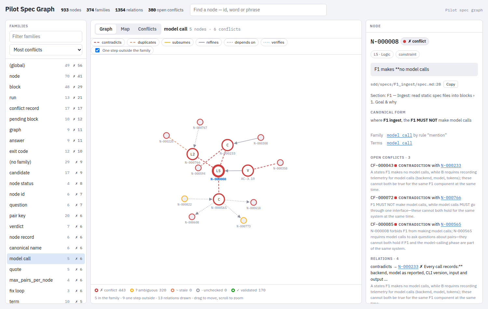

# MIA 5150 Project Proposal

<!-- DRAFT 2026-09-29 for owner review. Markdown first; LaTeX (NeurIPS 2026) only after approval.
     Source comments (src: …) are for the owner and are stripped at the LaTeX build.
     Every "$" figure is Claude Code's own total_cost_usd, an estimated API-equivalent, not money billed. -->

**Title (working):** Flat, tiered or graph? How the shape of a specification changes the code an AI coding agent writes

## Team Members and Project Category

(OWNER): Only 1 member in this project: Victor Truong (student number 300264088).

**Category:** Benchmark and empirical study (a controlled comparison on one task).
Confirmed by the owner.

## One-Sentence Testable Claim

We claim that **a frontier AI coding agent writes better code from a structured, graph-based specification than from the same specification written as one long flat prompt or as tiered spec-driven-development (SDD) files**, and we will show it by measuring **code quality** (share of the benchmark's tests passed), **hallucination** (requirements the agent invents) and **spec omission** (requirements the agent leaves out), on **tasks from public AI-coding benchmarks**.

<!-- Owner's wording, polished. Four blanks: claim / measuring / against / on. -->

## Problem and Motivation

Coding agents are now asked to build software from written specifications. But the specification is usually handed over as one long prompt (vibe coding) or a tiered folder of Markdown files (Spec-Driven-Development method). Long inputs are used unevenly: models use the start and end of a long context better than the middle (Liu et al.), so a requirement buried in a long spec can be dropped or replaced by what the model finds typical. Spec-driven development answers this with tiered files (a vision, a constitution, one spec per feature). However cross-file contradictions and duplication pose significant challenge as well. A further step is to compile the specs into a **graph** of small requirement nodes with terms and links, so the agent gets a checklist, a vocabulary and the relations between requirements.

Whether that extra structure improves the code, or only adds cost, is untested. We compare the three representations with everything else fixed. A null result is still a finding, and the agent's own list of what it had to invent shows what a graph must carry.

## Related Work

<!-- Each paper was opened at its arXiv abstract page (the authors' own text) on 2026-09-29. Full text was NOT read for any of them, so every claim below is limited to what the abstract states. Details: proposal-notes.md §3. -->

**Code-generation scoring.** Chen et al. (2021) introduce HumanEval and the *pass@k* metric for functional correctness on short function-writing tasks. Jimenez et al. (ICLR 2024) score whole-repository edits by hidden tests on 2 294 real GitHub issues (SWE-bench). Both score *does the code pass tests* with one fixed task text. We keep the tests but vary how the same requirements are represented, and add omission and hallucination counts.

**Weak tests hide errors.** Liu et al. (NeurIPS 2023, EvalPlus) add about 80× more tests to HumanEval and report pass@k falling by 19.3–28.9 %. So a passing test suite alone is not trusted as the measure of quality; we add an independent audit of omissions.

**Nearest setting to ours.** Doc2Feat-Bench (Jiang et al., arXiv 2025; earlier NoCode-bench) pairs a *documentation change* with the implementation and developer tests, and reports that agents struggle with cross-file edits and with "interpreting documentation semantics". It fixes the documentation format and varies the agent; we vary the specification's representation.

**Hallucination in generated code.** Zhang et al. (ISSTA 2025) build a hallucination taxonomy from six LLMs and propose retrieval-based mitigation. We do not re-derive a taxonomy; we count two narrow kinds: *invented requirements* and *invented libraries or interfaces*. Liu et al. (TSE) label 3 120 code samples from four LLMs on HumanEval and CoderEval (Cohen's κ 0.76–0.96) and find *requirement conflicting*, code that does something other than asked, is the largest class (39.60 %), the very class a specification is meant to prevent. Spracklen et al. (USENIX Security 2025) find non-existent packages in about 5.2 % of samples for commercial models and 21.7 % for open-source ones, over 576 000 samples, which gives a cheap automatic count of invented libraries.

**Context position.** Liu et al. (TACL 2023, *Lost in the Middle*) show that models use information at the start and end of a long input better than the middle. This is the mechanism we expect to hurt the flat spec format, so the flat format's file order is fixed and the position of each requirement is recorded. Length alone also hurts: Levy et al. (ACL 2024) report reasoning degrading at input lengths well below the maximum; Hsieh et al. (COLM 2024, RULER) report that only half of 17 long-context models keep satisfactory performance at 32K tokens; and Shi et al. (ICML 2023) show that irrelevant text in the prompt lowers accuracy.

**Size of the unit, and how the agent reads.** ClassEval (Du et al. 2023) finds every model much worse on whole classes than on single functions, and that generating a whole class at once suits only the strongest models while weaker ones do better method by method. We take this as a hypothesis: the smaller Haiku may gain more from a graph that hands it one unit at a time than Opus does. SWE-agent (Yang et al. 2024) shows that a purpose-built agent-computer interface changed the performance of the same model, so the file layout an agent reads is itself a variable. Aider's repository map (documentation) gives the model a compact, ranked overview so it can "figure out which files it needs to look at", and GraphRAG (Edge et al. 2024) pre-computes summaries of clusters in a graph for questions about a whole corpus; both are precedents for putting a map or graph between the agent and a large body of text. Anthropic's context-engineering guidance (2025) recommends light identifiers and loading detail just in time.

**Format is a confound.** He et al. (2024) report up to 40 % variation for GPT-3.5-turbo on a code-translation task across plain text, Markdown, JSON and YAML templates, with larger models more robust; Sclar et al. (ICLR 2024) report differences of up to 76 accuracy points on LLaMA-2-13B from formatting changes alone. So all three spec formats carry the same requirement text; only structure and layout change.

**Judging and statistics.** Zheng et al. (NeurIPS 2023) document position, verbosity and self-preference biases of LLM judges, with over 80 % agreement with human preferences for strong judges; so LLM judging is used only for triage, calibrated against human labels. Miller (2024) argues evals should report error bars, paired comparisons and planned power; we compare spec formats on the same tasks.

## Proposed Approach

### Models

Claude Haiku, Claude Sonnet and Claude Opus. Model id, effort and Claude Code version are recorded per run. No local or open-weights model, hence no GPU.

### Data and Tasks

**Main study: our own tasks.** A small set of feature-implementation tasks written by us, each with a specification, a hidden test suite and a numbered requirement list, packaged as one task per directory so that any of the candidate platforms can run it. The same content is rendered three ways.

**Outside validity: one public benchmark.** One spec-like public benchmark, the specification re-rendered in the three forms. Candidates, to be picked after a look at licence, size and whether inputs can be replaced: ProjectEval (input levels: prompt, checklist, code skeleton), RealBench (text requirements plus UML), or Doc2Feat-Bench. See `metrics-and-platforms-survey.md`.

**Test platform: undecided, one to pick.** ProjectEval, RealBench or Harbor. Harbor packages custom tasks and records per-trial time, cost, tokens and retries; ProjectEval and RealBench are correctness benchmarks. Efficiency metrics come from Claude Code's own logs whichever platform scores correctness.

**Study artifact.** For each task, the same specification content in three forms. **Flat:** one long Markdown file in a fixed order. **Tiered:** SDD layout, with a short vision and rules file and one file per feature. **Graph:** the same content compiled by the SDD Compiler into a graph of requirement nodes, terms and links, read by the agent as files. The agent is told to read only the specification in its own spec format and nothing else. A script checks that all three forms contain the same requirements before any run.

### Experimental Variables

- **Varied, spec format:** flat, tiered, graph.
- **Varied, agent:** Haiku, Sonnet, Opus.
- **Hypotheses (stated before running):** the graph ties with flat and tiered on clean, single-file specs and helps on messy, multi-file specs (duplicates, scattered refinements, contradictions), which is a design judgement, not a result; and the smaller model gains more than the larger (ClassEval). Our own tasks include both clean and messy specs.
- **Held fixed:** the task text apart from one line naming where the specification is, the tool list and permission mode, an empty output directory, model id and effort, and the turn cap.
- **Repetitions:** design value 2 per (task, spec format, agent); the pilot may change it.
- **Known confound:** the compiled graph may not carry every sentence of the source. We score against the requirement list of the source specification, not the graph's own node list, so a requirement lost in compiling counts as an omission of the graph spec format.

## Baseline and Trial-Run Result

**Trial run: the real graph of our own specs.** We compiled this project's specification set with the SDD Compiler. The input is 9 Markdown files under `sdd/specs/`: a vision, a constitution, a README and six feature specs, one folder per feature (`F1_ingest` … `F6_conflicts`). The compile turned 845 text blocks into **933 requirement nodes in 374 families**, using 3 507 model calls (2 673 + 834 for later fixes), about $70.06 estimated API-equivalent (54.94 + 15.12), and 9.05 h for the first compile <!-- src: M4-gate.md §8 (first compile); build-plan.md I-94 (fix runs, 834 calls, $15.12); 933 nodes and 374 families from the header of the viewer built from the frozen pilot graph; time of the fix runs not measured -->. The graph is frozen and read-only; every study run reads it. Appendix A shows it. No coding agent has been run on it yet: the first per-run figures (time, cost, tokens) come from the week-6 pilot.

## Evaluation Plan and Metrics

We look into four groups of measures, and to fix the exact list, scoring scripts and rubrics in the first weeks of the project (weeks 5–6), after the pilot. Tests give a reproducible score; an audit of a seeded random sample, labelled blind to spec format and re-labelled by the same person a few days later (agreement reported with Cohen's κ), covers what tests cannot; an LLM judge is used only for triage, calibrated against human labels.

1. **Code quality:** hidden tests passed, plus the measures in Table 1.
2. **Hallucination:** invented requirements, and invented libraries or interfaces, using the measures in Table 2.
3. **Spec omission:** the share of numbered requirements the code does not implement, using the measures in Table 3.
4. **Efficiency:** completion time, estimated API-equivalent cost, input and output tokens, files read and edited, failed commands and number of tries, taken from Claude Code's own logs, to show whether the graph helps or slows the agent.

Candidate measures, from the literature (source pages opened 2026-09-29; details in `metrics-and-platforms-survey.md`):

**Table 1. Code quality**

| Metric | What it measures / how | Source (opened) |
| --- | --- | --- |
| pass@k | Share of tasks with ≥ 1 of k samples passing all tests | Chen et al. 2021 (arXiv 2107.03374) |
| Resolved rate | Share of tasks whose patch makes the designated failing tests pass without breaking others | Jimenez et al., ICLR 2024 (arXiv 2310.06770) |
| Test-suite strength | Stronger tests lower measured pass rates: HumanEval+ has about 80× more tests, pass@k falls 19.3–28.9 % | Liu et al., NeurIPS 2023 (arXiv 2305.01210) |
| Efficiency | Speed of generated code (EvalPerf) | EvalPlus README |
| Non-functional quality: security, maintainability, performance efficiency, guided by ISO/IEC 25010 | Sun et al. (arXiv 2511.10271) report a gap between what research measures and what practitioners value (maintainability, readability), and that prompting alone did not reliably improve them | Sun et al. 2025/26 |
| Similarity to a reference (BLEU-like, AST similarity, Token F1) | ProjectEval uses it beside execution; the portability study reports Token F1, AST similarity and syntax validity | Liu et al. ProjectEval (2503.07010); Grynets et al. (2608.21208) |
| LLM-as-judge quality | An LLM scores correctness or usefulness | Zheng et al. NeurIPS 2023; Crupi et al., TSE 2025 (arXiv 2507.16587); DevBench 2026 uses "LLM-judge assessments" |

**Table 2. Hallucination**

| Metric / taxonomy | What it counts | Source (opened) |
| --- | --- | --- |
| HalluCode taxonomy | 3 primary and 12 specific hallucination categories in generated code, plus a benchmark | Liu et al., TSE (arXiv 2404.00971) |
| Practical-generation taxonomy | Taxonomy from six LLMs, repository-level dependency context; retrieval mitigation | Zhang et al., ISSTA 2025 (arXiv 2409.20550) |
| CodeHalu | Four types (mapping, naming, resource, logic), detected by **execution-based verification**; 8 883 samples from 699 tasks | Tian et al., AAAI 2025 (arXiv 2405.00253) |
| Package hallucination rate | Share of suggested packages that do not exist in the official registry; 576 000 samples, 16 LLMs; commercial ≈ 5.2 %, open-source ≈ 21.7 % as reported | Spracklen et al., USENIX Security 2025 (arXiv 2406.10279) |
| Groundedness under unsatisfiable prompts | Whether the model fabricates or refuses when the task cannot be done; 270 prompts, 6 languages; Cohen's κ 0.73 against human judgement | Dasu, Kundu, Tan (arXiv 2609.03267) |
| Survey with taxonomy, benchmarks, metrics | Reviews taxonomies, benchmarks and mitigation | Lee et al. (arXiv 2504.20799) |
| SBC score | "Reconstructs system requirements from AI-generated code and compares them with the original specifications"; combines semantic similarity, BLEU and a completeness check; flags missing features and hallucinations | Ponnusamy (arXiv 2502.07835) |

**Table 3. Spec omission (requirement coverage)**

| Metric | What it measures | Source (opened) |
| --- | --- | --- |
| SBC completeness | Missing features found by reverse-generating requirements from code and comparing to the spec | Ponnusamy (2502.07835) |
| Prompt Coverage Adequacy | How well a **test suite** satisfies the requirements in a prompt, via LLM attention; reported to find over 30 % more faults than code coverage when guiding test generation | Tambon et al. (arXiv 2607.02057) |
| API coverage | Share of specified endpoints the generated repository implements (RepoGenesis, reported up to 73.91 %) | Repo-level benchmark (arXiv 2601.13943) |
| Functionality coverage | Share of required functionality covered, reported beside pass rate | Repo0 (arXiv 2608.19854) |
| Requirement success rate with a traceability graph | Success rate on 125 use cases; the Validator agent builds a graph linking requirements, design and code | TraceDev (arXiv 2607.18886) |
| Omission as a spec defect | WiseSpec names Conflict, Omission and Ambiguity as *requirement* deficiencies, not code omissions | WiseSpec (arXiv 2609.00568) |

**Statistics (fixed before running):** spec formats compared on the same tasks (paired); run-clustered bootstrap confidence intervals; nothing dropped after the fact; every run reported, failures included.

## Compute Budget

**GPU: none.** All models are hosted, so the brief's 15 GB / 20 GPU-hour limits do not bind. We budget model calls and estimated API-equivalent dollars, and the subscription's session limit.

```
runs          = tasks × spec formats × agents × repetitions = 5 × 3 × 3 × 2 = 90     (design values)
model calls   = runs × calls per run      calls per run: TO BE MEASURED in the pilot
est. $ (runs) = runs × $ per run          $ per run, per agent: TO BE MEASURED (Haiku, Sonnet, Opus)
graph compile = tasks × calls per compile compile calls per task: TO BE MEASURED
```

The compile's $0.0206 per call is **not** a per-run figure: a compile call answers one short question, an agent run makes many long calls. Opus will cost more per run than Haiku; by how much is to be measured. If 90 runs exceed the session limit, the plan shrinks (see Risks).

## Week-by-Week Plan

Dates from the course schedule. One member, Victor Truong, does every task.

| Week | Dates | Task | Who |
|---|---|---|---|
| 4 | to 2 Oct | Proposal; compile the real graph (done); shortlist public benchmarks | Victor |
| 5 | 5–9 Oct | Pick the test platform among ProjectEval, RealBench and Harbor (can it score a Claude Code project? per-trial fields?); choose tasks; write the requirement lists; build the three renderings and the parity check | Victor |
| 5 | 5–9 Oct | Run harness (headless runs, test runner, logs) | Victor |
| 6 | 12–16 Oct | Pilot: 1 run per spec format per model; measure calls and $ per run; fix repetitions | Victor |
| 7–8 | 19–30 Oct | Main runs, interleaved across days; run the scoring scripts after each | Victor |
| 7–8 | 19–30 Oct | Blind omission audits; re-label a sample for agreement | Victor |
| 9 | 2–6 Nov | Analysis; **check-in 6 Nov** | Victor |
| 10 | 9–13 Nov | Hallucination counts; the list of what the agents invented | Victor |
| 11 | 16–20 Nov | Draft report; slides | Victor |
| 12 | 23–27 Nov | Rehearse; **presentation 27 Nov** (or 4 Dec) | Victor |
| 13 | 30 Nov–4 Dec | Final report (6 pages), README with seeds and how to reproduce | Victor |

## Risks and Smaller Backup Project

- **No agent run yet.** The trial number describes the graph, not an agent; the first agent numbers come from the week-6 pilot.
- **Platform undecided.** ProjectEval and RealBench may not accept projects made outside their own pipeline (unconfirmed); Harbor's Claude Code agent must work on the subscription login. Headless `--bare` mode needs an API key, so it is not used.
- **Benchmarks may not fit.** Popular coding benchmarks (HumanEval, SWE-bench) do not ship specifications that can be rendered three ways; Doc2Feat-Bench is the candidate found so far, and its licence, size and ease of running are not yet checked. If none fits, fall back to the backup.
- **Compile cost of the graph spec format.** Every task's specification must be compiled; the measured cost of one full compile (above) is large, and small tasks may cost far less. To be measured.
- **Subscription limit.** Compile rounds hit the session limit 5 times in 16 rounds <!-- src: M4-gate.md §8 -->; 90 runs with Opus may too. Mitigation: interleave spec formats, cap calls per run, drop Opus or repetitions.
- **Compiler gaps.** The graph may lose content; scored as omission of the graph spec format, and reported.
- **Variance.** Runs are stochastic; 2 repetitions may be too few. Reported as intervals; a null result is valid.
- **Audit load.** Sample size may drop to 10 per run.

**Smaller backup:** two spec formats (tiered vs graph), Haiku and Sonnet only, 3 tasks, 3 repetitions, on a small hand-picked specification set, primary metric omission rate. Fewer runs (3 × 2 × 2 × 3 = 36, design value), no Opus, no flat spec format.

## References

<!-- Refs 1–18: arXiv abstract page opened 2026-09-29; full text not read, except ref 9 whose taxonomy percentages and sample counts were read from the paper's HTML text (through a summarising fetch). Refs 19–20 are documentation and a blog, not papers. Author lists as printed on the pages. -->

1. M. Chen, J. Tworek, H. Jun, Q. Yuan, H. Ponde de Oliveira Pinto, J. Kaplan, et al. *Evaluating Large Language Models Trained on Code.* arXiv:2107.03374, 2021. https://arxiv.org/abs/2107.03374
2. C. E. Jimenez, J. Yang, A. Wettig, S. Yao, K. Pei, O. Press, K. Narasimhan. *SWE-bench: Can Language Models Resolve Real-World GitHub Issues?* ICLR 2024. https://arxiv.org/abs/2310.06770
3. J. Liu, C. S. Xia, Y. Wang, L. Zhang. *Is Your Code Generated by ChatGPT Really Correct? Rigorous Evaluation of Large Language Models for Code Generation.* NeurIPS 2023. https://arxiv.org/abs/2305.01210
4. Z. Jiang, L. Deng, J. Cao, M. Pradel, Z. Liu. *Doc2Feat-Bench: Evaluating Documentation-Driven Feature Addition* (earlier: NoCode-bench). arXiv:2507.18130, 2025. https://arxiv.org/abs/2507.18130
5. Z. Zhang, Y. Wang, C. Wang, J. Chen, Z. Zheng. *LLM Hallucinations in Practical Code Generation: Phenomena, Mechanism, and Mitigation.* ISSTA 2025. https://arxiv.org/abs/2409.20550
6. N. F. Liu, K. Lin, J. Hewitt, A. Paranjape, M. Bevilacqua, F. Petroni, P. Liang. *Lost in the Middle: How Language Models Use Long Contexts.* TACL, 2023. https://arxiv.org/abs/2307.03172
7. L. Zheng, W.-L. Chiang, Y. Sheng, S. Zhuang, Z. Wu, Y. Zhuang, Z. Lin, Z. Li, D. Li, E. P. Xing, H. Zhang, J. E. Gonzalez, I. Stoica. *Judging LLM-as-a-Judge with MT-Bench and Chatbot Arena.* NeurIPS 2023 Datasets and Benchmarks. https://arxiv.org/abs/2306.05685
8. E. Miller. *Adding Error Bars to Evals: A Statistical Approach to Language Model Evaluations.* arXiv:2411.00640, 2024. https://arxiv.org/abs/2411.00640

9. F. Liu, Y. Liu, L. Shi, Z. Yang, L. Zhang, X. Lian, Z. Li, Y. Ma. *Beyond Functional Correctness: Exploring Hallucinations in LLM-Generated Code.* IEEE TSE. https://arxiv.org/abs/2404.00971
10. J. Spracklen, R. Wijewickrama, A H M N. Sakib, A. Maiti, B. Viswanath, M. Jadliwala. *We Have a Package for You! A Comprehensive Analysis of Package Hallucinations by Code Generating LLMs.* USENIX Security 2025. https://arxiv.org/abs/2406.10279
11. X. Du, M. Liu, K. Wang, H. Wang, J. Liu, Y. Chen, J. Feng, C. Sha, X. Peng, Y. Lou. *ClassEval: A Manually-Crafted Benchmark for Evaluating LLMs on Class-level Code Generation.* arXiv:2308.01861, 2023. https://arxiv.org/abs/2308.01861
12. M. Levy, A. Jacoby, Y. Goldberg. *Same Task, More Tokens: the Impact of Input Length on the Reasoning Performance of Large Language Models.* ACL 2024. https://arxiv.org/abs/2402.14848
13. C.-P. Hsieh, S. Sun, S. Kriman, S. Acharya, D. Rekesh, F. Jia, Y. Zhang, B. Ginsburg. *RULER: What's the Real Context Size of Your Long-Context Language Models?* COLM 2024. https://arxiv.org/abs/2404.06654
14. F. Shi, X. Chen, K. Misra, N. Scales, D. Dohan, E. Chi, N. Schärli, D. Zhou. *Large Language Models Can Be Easily Distracted by Irrelevant Context.* ICML 2023. https://arxiv.org/abs/2302.00093
15. J. Yang, C. E. Jimenez, A. Wettig, K. Lieret, S. Yao, K. Narasimhan, O. Press. *SWE-agent: Agent-Computer Interfaces Enable Automated Software Engineering.* arXiv:2405.15793, 2024. https://arxiv.org/abs/2405.15793
16. D. Edge, H. Trinh, N. Cheng, J. Bradley, A. Chao, A. Mody, S. Truitt, D. Metropolitansky, R. O. Ness, J. Larson. *From Local to Global: A Graph RAG Approach to Query-Focused Summarization.* arXiv:2404.16130, 2024. https://arxiv.org/abs/2404.16130
17. J. He, M. Rungta, D. Koleczek, A. Sekhon, F. X. Wang, S. Hasan. *Does Prompt Formatting Have Any Impact on LLM Performance?* arXiv:2411.10541, 2024. https://arxiv.org/abs/2411.10541
18. M. Sclar, Y. Choi, Y. Tsvetkov, A. Suhr. *Quantifying Language Models' Sensitivity to Spurious Features in Prompt Design.* ICLR 2024. https://arxiv.org/abs/2310.11324
19. Aider. *Repository map.* https://aider.chat/docs/repomap.html (documentation, not a paper)
20. P. Rajasekaran, E. Dixon, C. Ryan, J. Hadfield (Anthropic). *Effective context engineering for AI agents.* 2025-09-29. https://www.anthropic.com/engineering/effective-context-engineering-for-ai-agents (engineering blog, not a paper)

<!-- Not counted, [UNVERIFIED — open before citing]: Hey et al. IEEE RE 2024 (traceability link recovery, only surveyed); Cemri et al. NeurIPS 2025 (MAST). -->

## Appendix A. Snapshot of the compiled graph

Screenshot of `graph.html` written by the compiler for the 933-node graph above. Left: families, most conflicts first. Centre: the nodes and relations of one family (*model call*). Right: one node, with its source line, canonical form and the relations attached to it.


