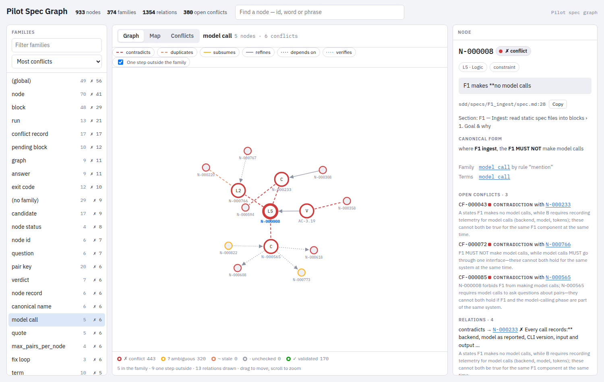

# MIA 5150 Project Proposal

<!-- AS SUBMITTED. This file mirrors `latex/main.tex` (the submitted proposal; compiled PDF:
     `latex/MIA5150-propjec-proposal-compiled.pdf`). Synced 2026-10-11. If this file and `main.tex`
     disagree, `main.tex` wins. Do not edit the proposal text here: later changes to the plan belong in
     the study's planning notes, not in the record of what was submitted.
     What the submission dropped from the 2026-09-29 draft is listed at the end of this file. -->

**Title:** Flat, Tiered or Graph? How the Structure of a Specification Changes the Code Written by AI

**Author:** Victor Truong · student number 300264088 · MIA 5150, University of Ottawa · ntruo093@uottawa.ca

## 1. Project Category

Its category is *benchmark and empirical study*: a controlled comparison of three ways of presenting the same specification to the same coding agent.

## 2. Testable Claim

We claim that **an AI coding agent produces code of higher quality from a structured, graph-based specification than from the same specification given as a single long flat prompt or as tiered spec-driven-development (SDD) files**, and we will show it by measuring **code quality, hallucination and specification omission**, on **our own feature-implementation tasks and an AI-coding benchmark**.

## 3. Problem and Motivation

Coding agents are increasingly asked to build software from written specifications. The specification is usually supplied either as one long prompt (vibe coding) or as a folder of tiered Markdown files, the layout of the spec-driven-development (SDD) method. Long inputs are not used evenly: models use information at the beginning and end of a long context better than information in the middle (Liu et al., *Lost in the Middle*), so a requirement buried in a long specification may be dropped or replaced by what the model finds typical. Tiering the files helps but does not remove the difficulty, because contradictions and duplication across files remain. A further step is to compile the specifications into a *graph* of small requirement nodes with terms and links, so that the agent receives a checklist, a vocabulary and the relations between requirements.

Whether this additional structure improves the generated code, or merely adds cost, has not been tested. We compare the three representations while holding everything else fixed. A null result would still be a finding, and the agent's own list of what it had to invent would show what a specification graph must carry.

## 4. Related Work

The related literature (scoring of generated code, hallucination in generated code, long-context effects, prompt-format effects, and evaluation statistics) is reviewed in Appendix C.

## 5. Proposed Approach

### 5.1 Models

Claude Haiku, Claude Sonnet and Claude Opus are used through Claude Code. No local or open-weights model is used, so no GPU is required.

### 5.2 Data and Tasks

**Main study: our own tasks.** A small set of feature-implementation tasks written by us. Each has a specification, a hidden test suite and a numbered requirement list, and is packaged as one task per directory so that any candidate evaluation platform can run it. The same content is rendered in three specification formats.

**External validity: one public benchmark.** One public benchmark whose task text is a specification, re-rendered in the same three formats. The candidates are ProjectEval (Liu et al. 2025) (input levels: prompt, checklist and code skeleton), RealBench (Li et al. 2026) (text requirements plus UML) and Doc2Feat-Bench (Jiang et al. 2025); the choice depends on licence, size and whether task inputs can be replaced.

**Evaluation platform (undecided).** ProjectEval, RealBench or Harbor (Harbor documentation); one will be selected in week 5. Harbor packages custom tasks and records per-trial time, cost, tokens and retries, whereas ProjectEval and RealBench are correctness benchmarks. Efficiency metrics are taken from Claude Code's own logs whichever platform scores correctness.

**Study artifact.** For each task the same specification content is supplied in three formats. *Flat*: one long Markdown file in a fixed order. *Tiered*: the SDD layout, with a short vision and rules file and one file per feature. *Graph*: the same content compiled by the SDD Compiler into a graph of requirement nodes, terms and links, read by the agent as files.

### 5.3 Experimental Variables

- **Varied, specification format:** flat, tiered, graph.
- **Varied, agent:** Haiku, Sonnet, Opus.
- **Hypotheses:** the graph ties with flat and tiered on clean, single-file specifications and helps on messy, multi-file specifications (duplicates, scattered refinements, contradictions); these are design judgements, not results. The smaller model gains more than the larger one (ClassEval). Our own tasks include both clean and messy specifications.
- **Fixed:** the task text, the tool list and permission mode, an empty output directory, the model identifier and effort, and the turn cap.
- **Repetitions:** two per (task, specification format, agent) as a design value.

## 6. Baseline and Trial-Run Result

**Trial run: the real graph of our own software.** We compiled this project's specification set with the SDD Compiler. The input is nine Markdown files: a vision, a constitution, a README and six feature specifications, one folder per feature. The compilation turned 845 text blocks into **933 requirement nodes in 374 families**, using 3 507 model calls (2 673 plus 834 for later fixes), and 9.05 h for the first compilation. This graph is shown in Appendix A.

## 7. Evaluation Plan and Metrics

Four groups of measures will be examined.

1. **Code quality:** hidden tests passed, together with the measures in Table 1.
2. **Hallucination:** invented requirements and invented libraries or interfaces, using the measures in Table 2.
3. **Specification omission:** the share of numbered requirements that the code does not implement, using the measures in Table 3.
4. **Efficiency:** completion time, estimated API-equivalent cost, input and output tokens, files read and edited, failed commands and number of tries, taken from Claude Code's own logs, to show whether the graph helps or slows the agent.

The candidate measures found in the literature are listed in Tables 1–3 in Appendix B.

## 8. Compute Budget

No GPU is required: all models are hosted, so the course limits of about 15 GB per job and 20 GPU-hours do not apply.

## 9. Week-by-Week Plan

| Week | Dates | Task | Who |
|---|---|---|---|
| 4 | to 2 Oct | Proposal; compile the real graph (done); shortlist public benchmarks | Victor |
| 5 | 5–9 Oct | Select the evaluation platform among ProjectEval, RealBench and Harbor (can it score a Claude Code project? which per-trial fields?); choose tasks; write the requirement lists; build the three renderings and the parity check | Victor |
| 5 | 5–9 Oct | Run harness (headless runs, test runner, logs) | Victor |
| 6 | 12–16 Oct | Pilot: one run per specification format per model; measure calls and dollars per run; fix the number of repetitions | Victor |
| 7–8 | 19–30 Oct | Main runs, interleaved across days; run the scoring scripts after each | Victor |
| 7–8 | 19–30 Oct | Blind omission audits; re-label a sample to measure agreement | Victor |
| 9 | 2–6 Nov | Analysis; **progress check-in, 6 Nov** | Victor |
| 10 | 9–13 Nov | Hallucination counts; list of what the agents invented | Victor |
| 11 | 16–20 Nov | Draft report; slides | Victor |
| 12 | 23–27 Nov | Rehearsal; **presentation, 27 Nov** (or 4 Dec) | Victor |
| 13 | 30 Nov–4 Dec | Final report (six pages), README with seeds and reproduction steps | Victor |

## 10. Risks and Smaller Backup Project

- **Platform undecided.** ProjectEval and RealBench may not accept projects produced outside their own pipeline (unconfirmed); Harbor's Claude Code agent must work with the subscription login.
- **Benchmarks may not fit.** Popular coding benchmarks (HumanEval, SWE-bench) do not ship specifications that can be rendered in three formats; Doc2Feat-Bench is the candidate found so far, and its licence, size and ease of execution are not yet checked. If none fits, the plan falls back to the backup below.
- **Compilation cost of the graph format.** Every task's specification must be compiled; the measured cost of one full compilation (Section 6) is large, and small tasks may cost far less. To be measured.
- **Compiler gaps.** The graph may lose content; this is scored as omission of the graph format and reported.
- **Variance.** Runs are stochastic and two repetitions may be too few; results are reported as intervals, and a null result is valid.
- **Audit load.** The audit sample may be reduced to 10 per run.

**Smaller backup project.** Two specification formats (tiered versus graph), Haiku and Sonnet only, 3 tasks and 3 repetitions on a small hand-picked specification set, with omission rate as the primary metric: 3 × 2 × 2 × 3 = 36 runs (design value), without Opus and without the flat format.

## References

<!-- The 37 entries of `latex/references.bib`, in that file's order (the PDF sorts them with plainnat).
     Per the .bib header: entries were checked against the arXiv abstract page or documentation page on
     2026-09-29; full texts were not read, except the taxonomy figures of Liu et al. (HalluCode), read
     from its HTML text. "to verify" notes are the .bib's own and are still open. -->

1. M. Chen, J. Tworek, H. Jun, Q. Yuan, H. Ponde de Oliveira Pinto, J. Kaplan, H. Edwards, Y. Burda, N. Joseph, G. Brockman, et al. *Evaluating Large Language Models Trained on Code.* arXiv:2107.03374, 2021.
2. C. E. Jimenez, J. Yang, A. Wettig, S. Yao, K. Pei, O. Press, K. Narasimhan. *SWE-bench: Can Language Models Resolve Real-World GitHub Issues?* ICLR 2024.
3. J. Liu, C. S. Xia, Y. Wang, L. Zhang. *Is Your Code Generated by ChatGPT Really Correct? Rigorous Evaluation of Large Language Models for Code Generation.* NeurIPS 2023. arXiv:2305.01210 *(venue to verify)*.
4. EvalPlus. *EvalPlus: HumanEval+, MBPP+ and EvalPerf* (repository documentation). https://github.com/evalplus/evalplus, accessed 2026-09-29.
5. Z. Jiang, L. Deng, J. Cao, M. Pradel, Z. Liu. *Doc2Feat-Bench: Evaluating Documentation-Driven Feature Addition* (earlier titled NoCode-bench). arXiv:2507.18130, 2025.
6. Z. Zhang, Y. Wang, C. Wang, J. Chen, Z. Zheng. *LLM Hallucinations in Practical Code Generation: Phenomena, Mechanism, and Mitigation.* ISSTA 2025.
7. F. Liu, Y. Liu, L. Shi, Z. Yang, L. Zhang, X. Lian, Z. Li, Y. Ma. *Beyond Functional Correctness: Exploring Hallucinations in LLM-Generated Code.* IEEE Transactions on Software Engineering, 2024. arXiv:2404.00971 *(accepted, volume to verify)*.
8. J. Spracklen, R. Wijewickrama, A H M N. Sakib, A. Maiti, B. Viswanath, M. Jadliwala. *We Have a Package for You! A Comprehensive Analysis of Package Hallucinations by Code Generating LLMs.* USENIX Security Symposium, 2025.
9. Y. Tian, W. Yan, Q. Yang, X. Zhao, Q. Chen, W. Wang, Z. Luo, L. Ma, D. Song. *CodeHalu: Code Hallucinations in LLMs Driven by Execution-based Verification.* AAAI 2025. arXiv:2405.00253.
10. V. A. Dasu, A. Kundu, G. Tan. *Refusing the Impossible: A Taxonomy and Benchmark for Code Hallucination in Large Language Models.* arXiv:2609.03267, 2026.
11. Y. Lee, J. Y. Song, D. Kim, J. Kim, M. Kim, J. Nam. *Hallucination by Code Generation LLMs: Taxonomy, Benchmarks, Mitigation, and Challenges.* arXiv:2504.20799, 2025.
12. A. A. N. Ponnusamy. *Bridging LLM-Generated Code and Requirements: Reverse Generation Technique and SBC Metric for Developer Insights.* arXiv:2502.07835, 2025.
13. F. Tambon, M. Konstantinou, C. Richter, C. Chenouard, M. Harman, M. Papadakis. *Prompt Coverage Adequacy.* arXiv:2607.02057, 2026.
14. X. Sun, D. Ståhl, K. Sandahl, C. Kessler. *Quality Assurance of LLM-generated Code: Addressing Non-Functional Quality Characteristics.* arXiv:2511.10271, 2025.
15. G. Crupi, R. Tufano, A. Velasco, A. Mastropaolo, D. Poshyvanyk, G. Bavota. *On the Effectiveness of LLM-as-a-judge for Code Generation and Summarization.* IEEE Transactions on Software Engineering, 2025. arXiv:2507.16587.
16. K. Liu, Y. Pan, Y. Xiang, D. He, J. Li, Y. Du, T. Gao. *ProjectEval: A Benchmark for Programming Agents Automated Evaluation on Project-Level Code Generation.* arXiv:2503.07010, 2025 *(ACL Findings 2025; venue to verify)*.
17. J. Li, H. Deng, Y. Zhang, et al. *RealBench: A Repo-Level Code Generation Benchmark Aligned with Real-World Software Development Practices.* arXiv:2604.22659, 2026.
18. O. Grynets, O. Ilchuk, D. Zatulna, V. Lyashkevych. *Specification Portability Across LLM Development Agents: Cross-Agent Compatibility in Specification-Driven Software Migration.* arXiv:2608.21208, 2026.
19. A. Kumarappan, P. A. Golnari, W. Wen, X. Liu, G. Ryan, Y. Sun, S. Fu, E. Nallipogu. *DevBench: A Realistic, Developer-Informed Benchmark for Code Generation Models.* arXiv:2601.11895, 2026.
20. Z. Peng, X. Yin, P. Zhao, F. Yang, L. Wang, R. Jia, X. Chen, Q. Lin, S. Rajmohan, D. Zhang. *RepoGenesis: Benchmarking End-to-End Microservice Generation from Readme to Repository.* arXiv:2601.13943, 2026.
21. S. Chen, H. Teng, X. Gu, Y. Shi, J. Huang, Y. Wang, H. Zhang, H. Guan. *Repo0: Design-Driven Zero-to-All Code Generation.* arXiv:2608.19854, 2026.
22. M. Chen, Y. Zhang, Z. Xie, Y. Luo, J. Xu, C. Gao, K. Zhao, Y. Ye. *TraceDev: A Traceability-Driven Multi-agent Framework for Requirement-to-Code Development.* arXiv:2607.18886, 2026 (accepted at ISSTA 2026).
23. Z. Tian. *WiseSpec: Requirements-Driven Agents for Code Generation.* arXiv:2609.00568, 2026 (ASE 2026 Student Research Competition).
24. N. F. Liu, K. Lin, J. Hewitt, A. Paranjape, M. Bevilacqua, F. Petroni, P. Liang. *Lost in the Middle: How Language Models Use Long Contexts.* Transactions of the Association for Computational Linguistics, 2024. arXiv:2307.03172 *(year to verify)*.
25. L. Zheng, W.-L. Chiang, Y. Sheng, S. Zhuang, Z. Wu, Y. Zhuang, Z. Lin, Z. Li, D. Li, E. P. Xing, H. Zhang, J. E. Gonzalez, I. Stoica. *Judging LLM-as-a-Judge with MT-Bench and Chatbot Arena.* NeurIPS Datasets and Benchmarks Track, 2023.
26. E. Miller. *Adding Error Bars to Evals: A Statistical Approach to Language Model Evaluations.* arXiv:2411.00640, 2024.
27. X. Du, M. Liu, K. Wang, H. Wang, J. Liu, Y. Chen, J. Feng, C. Sha, X. Peng, Y. Lou. *ClassEval: A Manually-Crafted Benchmark for Evaluating LLMs on Class-level Code Generation.* arXiv:2308.01861, 2023.
28. M. Levy, A. Jacoby, Y. Goldberg. *Same Task, More Tokens: the Impact of Input Length on the Reasoning Performance of Large Language Models.* ACL 2024.
29. C.-P. Hsieh, S. Sun, S. Kriman, S. Acharya, D. Rekesh, F. Jia, Y. Zhang, B. Ginsburg. *RULER: What's the Real Context Size of Your Long-Context Language Models?* COLM 2024.
30. F. Shi, X. Chen, K. Misra, N. Scales, D. Dohan, E. Chi, N. Schärli, D. Zhou. *Large Language Models Can Be Easily Distracted by Irrelevant Context.* ICML 2023.
31. J. Yang, C. E. Jimenez, A. Wettig, K. Lieret, S. Yao, K. Narasimhan, O. Press. *SWE-agent: Agent-Computer Interfaces Enable Automated Software Engineering.* arXiv:2405.15793, 2024.
32. D. Edge, H. Trinh, N. Cheng, J. Bradley, A. Chao, A. Mody, S. Truitt, D. Metropolitansky, R. O. Ness, J. Larson. *From Local to Global: A Graph RAG Approach to Query-Focused Summarization.* arXiv:2404.16130, 2024.
33. J. He, M. Rungta, D. Koleczek, A. Sekhon, F. X. Wang, S. Hasan. *Does Prompt Formatting Have Any Impact on LLM Performance?* arXiv:2411.10541, 2024.
34. M. Sclar, Y. Choi, Y. Tsvetkov, A. Suhr. *Quantifying Language Models' Sensitivity to Spurious Features in Prompt Design or: How I learned to start worrying about prompt formatting.* ICLR 2024.
35. Aider. *Repository map* (documentation, not a paper). https://aider.chat/docs/repomap.html, accessed 2026-09-29.
36. P. Rajasekaran, E. Dixon, C. Ryan, J. Hadfield. *Effective context engineering for AI agents.* Anthropic Engineering blog, 2025-09-29 (blog, not a paper). https://www.anthropic.com/engineering/effective-context-engineering-for-ai-agents
37. Harbor Framework. *Harbor documentation.* https://docs.harborframework.com, accessed 2026-09-29.

## Appendix A. Snapshot of the Compiled Graph

Figure 1 is a screenshot of the HTML viewer written by the compiler for the 933-node graph of Section 6.

*Figure 1: Snapshot of the compiled specification graph (frozen pilot graph).*

## Appendix B. Candidate Measures from the Literature

Tables 1–3 list the candidate measures for code quality, hallucination and specification omission (Section 7).

**Table 1. Candidate measures of code quality.**

| Metric | What it measures | Source |
| --- | --- | --- |
| pass@k | Share of tasks with at least one of k samples passing all tests | Chen et al. (2021) |
| Resolved rate | Share of tasks whose patch makes the designated failing tests pass without breaking others | Jimenez et al. (2024) |
| Test-suite strength | Stronger tests lower measured pass rates: HumanEval+ has about 80× more tests and pass@k falls by 19.3–28.9 % | Liu et al. (2023) |
| Efficiency of generated code | Speed of generated code (EvalPerf) | EvalPlus (2026) |
| Non-functional quality (security, maintainability, performance efficiency; ISO/IEC 25010) | A gap between what research measures and what practitioners value (maintainability, readability); prompting alone did not reliably improve these | Sun et al. (2025) |
| Similarity to a reference (BLEU-like, AST similarity, Token F1) | Used beside execution in ProjectEval; Token F1, AST similarity and syntax validity in the portability study | Liu et al. (2025); Grynets et al. (2026) |
| LLM-as-judge quality | An LLM scores correctness or usefulness | Zheng et al. (2023); Crupi et al. (2025); Kumarappan et al. (2026) |

**Table 2. Candidate measures of hallucination.**

| Metric or taxonomy | What it counts | Source |
| --- | --- | --- |
| HalluCode taxonomy | 3 primary and 12 specific hallucination categories in generated code, plus a benchmark | Liu et al. (2024, TSE) |
| Practical-generation taxonomy | Taxonomy from six LLMs, with repository-level dependency context; retrieval-based mitigation | Zhang et al. (2025) |
| CodeHalu | Four types (mapping, naming, resource, logic), detected by execution-based verification; 8 883 samples from 699 tasks | Tian et al. (2025) |
| Package hallucination rate | Share of suggested packages absent from the official registry; 576 000 samples, 16 LLMs; about 5.2 % (commercial) and 21.7 % (open-source) as reported | Spracklen et al. (2025) |
| Groundedness under unsatisfiable prompts | Whether the model fabricates or refuses when the task cannot be done; 270 prompts in six languages; Cohen's κ 0.73 against human judgement | Dasu et al. (2026) |
| Survey of taxonomies, benchmarks and metrics | Reviews taxonomies, benchmarks and mitigation | Lee et al. (2025) |
| SBC score | Reconstructs system requirements from generated code and compares them with the original specification; combines semantic similarity, BLEU and a completeness check; flags missing features and hallucinations | Ponnusamy (2025) |

**Table 3. Candidate measures of specification omission (requirement coverage).**

| Metric | What it measures | Source |
| --- | --- | --- |
| SBC completeness | Missing features found by reverse-generating requirements from code and comparing them with the specification | Ponnusamy (2025) |
| Prompt Coverage Adequacy | How well a *test suite* satisfies the requirements in a prompt, via LLM attention; reported to find over 30 % more faults than code coverage when guiding test generation | Tambon et al. (2026) |
| API coverage | Share of specified endpoints implemented by the generated repository (up to 73.91 % reported) | Peng et al. (2026) |
| Functionality coverage | Share of required functionality covered, reported beside pass rate | Chen et al. (2026, Repo0) |
| Requirement success with a traceability graph | Success rate on 125 use cases; a validator agent builds a graph linking requirements, design and code | Chen et al. (2026, TraceDev) |
| Omission as a specification defect | Conflict, omission and ambiguity as *requirement* deficiencies, not code omissions | Tian (2026) |

## Appendix C. Related Work

**Hallucination in generated code.** Zhang et al. (2025) derive a hallucination taxonomy from six LLMs and propose a retrieval-based mitigation. Liu et al. (2024, TSE) label 3 120 code samples from four LLMs on HumanEval and CoderEval (Cohen's κ 0.76–0.96) and find that *requirement conflicting* code, which does something other than what was asked, is the largest class (39.60 %): the class a specification is meant to prevent. Spracklen et al. (2025) report non-existent packages in about 5.2 % of samples for commercial models and 21.7 % for open-source models, over 576 000 samples, which provides an inexpensive automatic count of invented libraries. We do not derive a new taxonomy; we count two narrow kinds, invented requirements and invented libraries or interfaces.

**Context position, length and distraction.** Liu et al. (*Lost in the Middle*) show that models use information at the start and end of a long input better than in the middle. This is the mechanism we expect to affect the flat specification format, so the file order of that format is fixed and the position of each requirement is recorded. Length alone also degrades performance: Levy et al. (2024) report reasoning degrading at input lengths well below the maximum; Hsieh et al. (2024) report that only half of 17 long-context models keep satisfactory performance at 32K tokens; and Shi et al. (2023) show that irrelevant text in the prompt lowers accuracy.

**Unit size and how the agent reads.** ClassEval (Du et al. 2023) finds every model much worse on whole classes than on single functions, and that generating a whole class at once suits only the strongest models while weaker models do better method by method. We adopt this as a hypothesis: the smaller Haiku model may gain more from a graph that supplies one unit at a time than Opus does. SWE-agent (Yang et al. 2024) shows that a purpose-built agent–computer interface changes the performance of the same model, so the layout of the files an agent reads is itself a variable. Aider's repository map (Aider documentation) gives the model a compact ranked overview so that it can "figure out which files it needs to look at", and GraphRAG (Edge et al. 2024) pre-computes summaries of clusters in a graph to answer questions about a whole corpus; both are precedents for placing a map or graph between an agent and a large body of text. Anthropic's guidance on context engineering (Rajasekaran et al. 2025) likewise recommends keeping light identifiers in context and loading detail just in time.

**Format as a confound.** He et al. (2024) report up to 40 % variation for GPT-3.5-turbo on a code-translation task across plain-text, Markdown, JSON and YAML templates, with larger models more robust; Sclar et al. (2024) report differences of up to 76 accuracy points on LLaMA-2-13B from formatting changes alone. All three specification formats therefore carry the same requirement text; only structure and layout change.

**Scoring of generated code.** Chen et al. (2021) introduced HumanEval and the pass@k metric for functional correctness on short function-writing tasks. Jimenez et al. (2024) score whole-repository edits by hidden tests on 2 294 real GitHub issues (SWE-bench). Both measure whether the code passes tests for one fixed task text. We keep tests but vary how the same requirements are represented, and we add counts of omissions and hallucinations. Liu et al. (2023) add about 80× more tests to HumanEval and report that pass@k falls by 19.3–28.9 %, so a passing test suite alone is not accepted as a measure of quality; we add an independent audit of omissions.

**Closest setting.** Doc2Feat-Bench (Jiang et al. 2025) pairs a documentation change with the corresponding implementation and developer tests, and reports that agents struggle with cross-file edits and with interpreting documentation semantics. It fixes the documentation format and varies the agent; we fix the agent and vary the representation of the specification.

**Judging and statistics.** Zheng et al. (2023) document position, verbosity and self-preference biases of LLM judges, with over 80 % agreement with human preferences for strong judges; LLM judging is therefore used only for triage and is calibrated against human labels. Miller (2024) argues that evaluations should report error bars, paired comparisons and planned power; we compare specification formats on the same tasks.

<!-- ============================================================================================
NOT PART OF THE SUBMISSION — what `main.tex` dropped or changed from the 2026-09-29 Markdown draft.
The draft's commitments below were never submitted, so they bind nothing; each needs a decision in the
study plan (keep, change or drop).

Dropped:
- Compute budget arithmetic: 5 tasks × 3 formats × 3 agents × 2 repetitions = 90 runs, and the
  "to be measured" lines for calls and $ per run. The submission states no run count for the main study
  (only the backup's 36). The brief asks for a compute budget "with the arithmetic".
- Trial-run cost: about $70.06 estimated API-equivalent (54.94 + 15.12). The submission gives calls and
  hours only.
- "No coding agent has been run on it yet" (trial-run section and Risks).
- Evaluation method paragraph: blind audit of a seeded random sample, re-labelled by the same person,
  agreement by Cohen's κ; LLM judge for triage only (the last point survives in Appendix C).
- Statistics fixed before running: paired comparison, run-clustered bootstrap intervals, nothing dropped
  after the fact, every run reported.
- Parity check sentence ("a script checks that all three forms contain the same requirements"); it
  survives only as a week-5 task.
- Known confound: scoring against the source specification's requirement list, not the graph's nodes.
  (Risks still says lost content counts as omission of the graph format.)
- Risk "Subscription limit" (session limit hit 5 times in 16 compile rounds).
- "Model id, effort and Claude Code version are recorded per run"; "the agent is told to read only the
  specification in its own format".
- "Fixed: the task text" lost its exception "apart from one line naming where the specification is".
- "Hypotheses (stated before running)" lost "stated before running".

Changed:
- Title; claim's "on" blank ("tasks from public AI-coding benchmarks" → "our own feature-implementation
  tasks and an AI-coding benchmark"); "frontier AI coding agent" → "AI coding agent".
- Related Work moved to Appendix C; candidate-measure tables moved to Appendix B.
- References: 20 numbered → the 37 entries of `references.bib` (4 of them documentation or blog pages).
============================================================================================ -->
