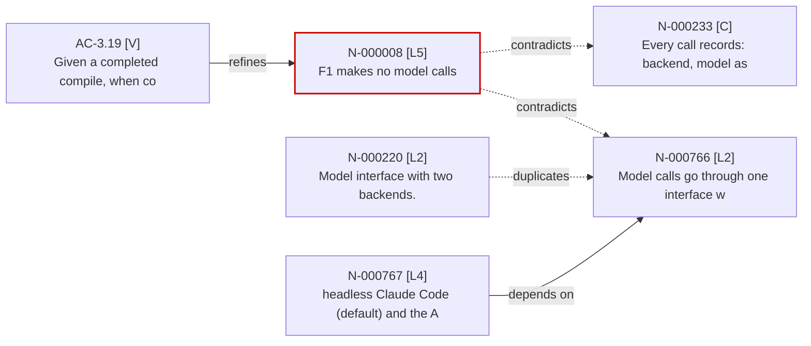

# 8. Where the graph lives, and how to look at it

## The store: `.sdd/`

Everything the compiler knows is plain text in one folder, next to the specs. There is no database:
JSON Lines files, one record per line, with a fixed key order and sorted, so two builds from the same
input are byte-identical and a `git diff` of the store is readable.

```text
.sdd/
├── profile.yaml            ← the only file you edit
├── sources.jsonl           one line per spec file: path and hash
├── blocks.jsonl            every block (chapter 4), including removed ones
├── runs.jsonl              one line per run: command, files, counts
├── terms.jsonl             the term registry (chapter 5)
├── nodes/<family>.jsonl    nodes, one file ("shard") per family
│   ├── _global.jsonl       constraints scoped to no single family
│   └── _unplaced.jsonl     nodes with no family
├── edges/<family>.jsonl    links, stored with their families
├── conflicts.jsonl         every conflict record, open and resolved
├── conflicted_nodes.json   derived: the nodes currently in a conflict
├── review.jsonl            attention items for a person (failed blocks, term merges, inferred facts)
├── adjudications.jsonl     human verdicts on conflicts (created by `conflicts judge`)
├── graph.meta.json         schema versions, counts, id counters
├── lock/                   the judgment lock: q-atom, q-desc, q-term, q-pair .jsonl
├── views/                  GENERATED Markdown — never edit
│   ├── map.md
│   ├── conflicts.md
│   └── families/<family>.md
├── export/                 GENERATED by `sddc export` (default --out) — replaced whole each time
│   ├── MAP.md  CHECKLIST.md  export.meta.json
│   └── packs/NN-<spec>--<section>.md
└── run.lock                present only while a compile is writing
```

`export/` exists only after `sddc export` has run. It is a reading format for an agent, not part of
the graph: the export only reads the store, never changes it (F7 §2), and its `store_hash` in
`export.meta.json` says which store it was made from.

**Writing is all or nothing.** Every compile derives what is derived (status, conflict fields, the
registry, counts), validates every record against its schema, runs the store's consistency checks
(unique ids, links resolve, status derived, conflict membership, registry derived, shard placement,
judgment references, counters monotonic), stages every file, then renames them together. A violation
aborts with exit `4`, names every problem, and leaves the old store untouched.

## Where the real stores are

| What | Where |
|---|---|
| **R18** (950 nodes, 381 conflicts; rel01 code) | **`~/sddc-runs/full-corpus/.sdd/`**, and a copy of the whole run directory in the repository at **`sdd/archive/rel-01/trial_01/full-corpus/`** |
| The spec text R18 was compiled from, frozen | `~/sddc-runs/full-corpus/sdd/specs/` and its hashes in `corpus.sha256` |
| Backups taken before the I-85 repair and the I-89 heal | `~/sddc-runs/full-corpus/.sdd.bak-before-I85-reset/`, `.sdd.bak-before-I89-heal/` |
| An interactive explorer of R18 | `~/sddc-runs/full-corpus/graph.html` (section 5 below) |
| R18's per-round output, report, conflict list, M2 sample | `sdd/archive/rel-01/design/rel01_design/measurements/R18_*` — in the repository |
| R18's write-up | `sdd/archive/rel-01/design/rel01_design/M4-gate.md` §8 |
| **The pilot graph** (R-000023, 933 nodes, 380 conflicts; rel01 at close, with adjudications) and its export | `~/sddc-runs/pilot-graph-R000023/` (the store files sit at the top level, not in `.sdd/`) · `~/sddc-runs/pilot-export-R000023/` |
| **The R21 store** (1 126 nodes, 233 conflicts; current code) | `harness/trials/r21-zero2repo-case016-conflicts-gaps/work/compile-full/.sdd/` |
| Every other rel02 compile | `harness/trials/r*/work/compile-*/.sdd/` — one per trial arm; the trial's `TRIAL.md` says which is which |

Point any command at a store with `--root` (the folder that *holds* `.sdd/`):

```bash
sddc --root ~/sddc-runs/full-corpus status
sddc --root ~/sddc-runs/full-corpus family "model call"
```

Today's code still reads R18, but reports **26 pending** where R18's last run left 1. The difference is
R18's 25 contract fences, which the current rules make pending (chapter 4). The numbers in this
chapter are R18's as it was compiled.

*Fixed 2026-09-24 (build-plan I-89):* judged links used to be stored again each time their verdict
was replayed — R18 held 9 682 link lines for 4 199 distinct links. The store has been healed and a
duplicate link key now fails the store checks. *Fixed in rel01 (I-91, F6 D20):* a re-judged pair whose
verdict changes now keeps only the new verdict's links.

## How a person should look at it — from the top down

A graph of 950 nodes and 4 199 links drawn all at once is a hairball; nobody learns anything from it.
Read it the way you read an atlas: the world map first, then one country, then one street.

### 1. The map — `.sdd/views/map.md`

Families as rows, layers as columns. Each cell is `count mark`, where the mark is the **worst status**
among those nodes: `✗` conflict · `?` ambiguous · `~` stale · `·` unchecked · `✓` validated. Rows are
sorted by open conflicts, most first. From R18:

```text
| family          | L0 | L1  | L2   | L3  | L4   | L5  | C   | V    | —   |
| node            |    | 5 ✗ | 11 ✗ | 1 ✓ | 21 ✗ | 8 ✗ | 9 ✗ | 20 ✗ | 1 ? |
| block           |    | 5 ✗ | 4 ✗  |     | 14 ✗ | 4 ✗ | 8 ✗ | 11 ✗ |     |
| conflict_record |    | 2 ✗ | 4 ✗  |     | 3 ✗  | 1 ? | 1 ? | 6 ✗  |     |
```

Read it as: "the `node` family has 76 claims spread over every layer, and conflicts in most of them".

### 2. A family card — `.sdd/views/families/<name>.md` or `sddc family NAME`

One family's nodes grouped by layer, each line linked to the exact source line; then **"In scope from
elsewhere"** (constraints that cover this family) and **"Related families"**. R18's `model_call`:

```text
## Family: model_call
**Also called:** call
### L2 (1)
- N-000766 ✗ Model calls go through one interface with two backends
### L5 (1)
- N-000008 ✗ F1 makes no model calls
### C (2)
- N-000233 ✗ Every call records: backend, model as reported, CLI version, …
- N-000565 ✗ Ask the model one question about one pair at a time, …
### V (1)
- AC-3.19 ✗ Given a completed compile, when compile runs again with no source change …
### In scope from elsewhere (10)
…
**Related families:** backend, cli_version, link, pair_key, spec_set, status
```

The links open the spec at the line in any Markdown viewer that follows relative links (VS Code,
GitHub).

### 3. The conflicts — `.sdd/views/conflicts.md` or `sddc conflicts`

Records grouped by shared members (R18: 95 groups), contradictions first, each with both files and
lines and the judge's rationale. This is the work list.

### 4. A diagram of one family — `scripts/family_mermaid.py`

For a picture of how one family's claims relate, export it as a Mermaid diagram (any viewer that
renders Mermaid — GitHub, VS Code with a Mermaid extension — draws it):

```bash
cd ~/sddc-runs/full-corpus
PYTHONPATH=/path/to/sdd-compiler/src \
  python /path/to/sdd-compiler/docs/lectures/sdd-compiler-as-built/scripts/family_mermaid.py .sdd model_call > model_call.mmd
```

What it produced on R18 (abridged):



Dotted arrows are conflicts; solid arrows are ordinary relations. The script draws the family's nodes
plus every node one judged link away.

### 5. The interactive explorer — `scripts/build_viewer.py`

For browsing the whole graph, build a single self-contained HTML page from any store:

```bash
cd ~/sddc-runs/full-corpus
PYTHONPATH=/path/to/sdd-compiler/src \
  python /path/to/sdd-compiler/docs/lectures/sdd-compiler-as-built/scripts/build_viewer.py \
  .sdd graph.html --label "R18 · sdd/specs · 2026-09-23"
xdg-open graph.html        # or open it in any browser; it needs no server
```

It reads the store with the compiler's own loader and fills `viewer_template.html`. You get:

- **Families** on the left, sorted by open conflicts, by size, or A–Z, with a filter that matches
  aliases too;
- **Graph**: the selected family's nodes, drawn with their layer inside each circle and their status
  as its ring (✗ red conflict, ? amber ambiguous, ✓ green validated), plus nodes one judged relation
  outside the family. Contradictions are dashed red. Each relation type can be switched off. Drag to
  move, scroll to zoom, hover for the text;
- **Map**: families × layers, each cell showing the count and the worst status. Click a row to open it;
- **Conflicts**: all 381, filtered by kind or by the current family. Click a member to open it;
- **Details**: the full node record (text, `file:line` with a copy button, canonical form, family and
  the rule that chose it, terms, ambiguity, conflicts with rationale, every relation);
- **Find**: any node by id or words. `graph.html#N-000008` opens straight on a node.

The R18 build is at `~/sddc-runs/full-corpus/graph.html` (≈ 1.1 MB). Re-run on the R21 store with the
current code (2026-11-08): `1126 nodes, 791 links, 233 open conflicts, 898 KB` — the viewer draws
links between nodes, so the 2 804 `uses_term` links (node → term) are not among its 791.

### 7. A work list for adjudicating — `scripts/review_queue.py`

To judge many conflicts by hand, write them to a CSV:

```bash
PYTHONPATH=/path/to/sdd-compiler/src \
  python /path/to/sdd-compiler/docs/lectures/sdd-compiler-as-built/scripts/review_queue.py .sdd queue.csv
```

Each row joins a conflict record with the Q-PAIR answer behind it (confidence, provisional — neither
appears in `sddc conflicts`) and each member's status and location, plus its group and how many other
open records each member is in (a "hub" node: fix it once, settle several). Sorted biggest group
first, contradictions first, low confidence first. On the R21 store: `233 open conflicts, 87
low-confidence, 66 provisional`. Fill in `verdict` and `note`, then pass each to `sddc conflicts judge`.

### 8. The export — `sddc export`

The views above are for a person looking at the graph. The export is for an agent building from it:
the spec text again, verbatim, cut into packs by section, in a build order, with ids, settled conflicts
and a checklist. Chapter 9 is about it.

### 6. Ask questions of the files directly

The store is JSON Lines, so any tool reads it. Two useful one-liners:

```bash
# every open contradiction, one line each
jq -r 'select(.state=="open" and .kind=="contradiction") | "\(.id)  \(.members|join(" vs "))"' .sdd/conflicts.jsonl

# how many nodes per layer
cat .sdd/nodes/*.jsonl | jq -r '.layer // "none"' | sort | uniq -c | sort -rn
```

Or load it in Python with the compiler's own reader, which also runs the checks:
`from sdd_compiler.store.graph import load_graph; g = load_graph(Path(".sdd"))`.

## What not to do

- **Do not edit anything in `.sdd/` except `profile.yaml`.** The next compile would either overwrite
  it or refuse to write (exit `4`). To change the graph, change the spec text and compile. The one
  thing a person adds is a verdict, through `sddc conflicts judge`.
- **Do not hand-edit an export.** The next `sddc export` replaces the folder whole.
- **Do not trust a view you did not regenerate.** Views are rewritten by every compile; a copy pasted
  elsewhere goes stale.
