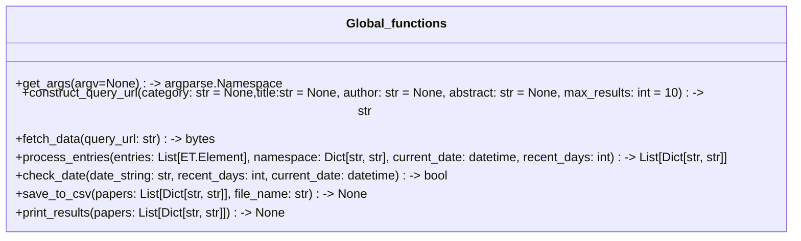

# Pack 01 — sdd/specs/UML_class.md · UML class
blocks 3 · nodes 1 (requirement 1) · AC labels: none

## Text
# UML class

`Global_functions` is a fake class to host global functions
↳ no node

```
classDiagram
    class Global_functions{
        +get_args(argv=None) -> argparse.Namespace
        +construct_query_url(category: str = None,title:str = None, author: str = None, abstract: str = None, max_results: int = 10) -> str
        +fetch_data(query_url: str) -> bytes
        +process_entries(entries: List[ET.Element], namespace: Dict[str, str], current_date: datetime, recent_days: int) -> List[Dict[str, str]]
        +check_date(date_string: str, recent_days: int, current_date: datetime) -> bool
        +save_to_csv(papers: List[Dict[str, str]], file_name: str) -> None
        +print_results(papers: List[Dict[str, str]]) -> None
    }
```
↳ no node


↳ N-000037 requirement · MUST · L2

## Claims to implement
- [N-000037] requirement · MUST · L2 — classDiagram
        class Global_functions{
            +get_args(argv=None) -> argparse.Namespace
            +construct_query_url(category: str = None,title:str = None, author: str = None, abstract: str = None, max_results: int = 10) -> str
            +fetch_data(query_url: str) -> bytes
            +process_entries(entries: List[ET.Element], namespace: Dict[str, str], current_date: datetime, recent_days: int) -> List[Dict[str, str]]
            +check_date(date_string: str, recent_days: int, current_date: datetime) -> bool
            +save_to_csv(papers: List[Dict[str, str]], file_name: str) -> None
            +print_results(papers: List[Dict[str, str]]) -> None
        }
  needs: none

## Acceptance criteria
None.

## Constraints in scope
None.

## Related elsewhere
None.

## Conflicts
None.

## Terms
- global function — defined: "`Global_functions` is a fake class to host global functions"
