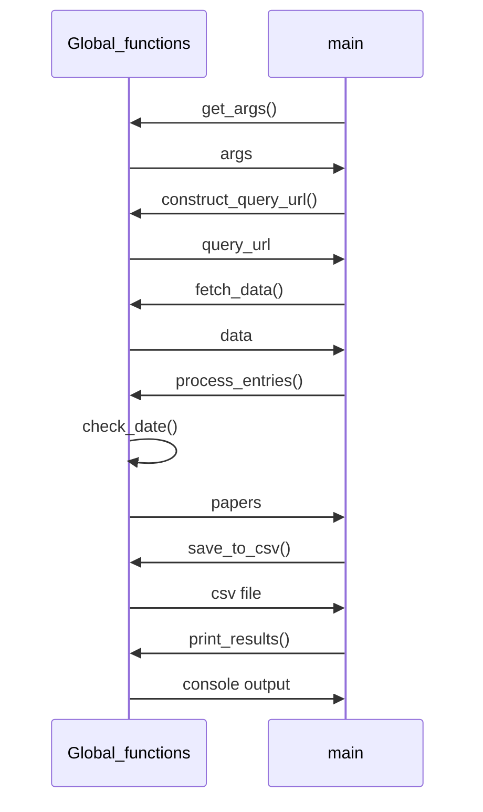

# Pack 11 — sdd/specs/UML_sequence.md · UML sequence
blocks 3 · nodes 1 (requirement 1) · AC labels: none

## Text
# UML sequence

`Global_functions` is a fake class to host global functions
↳ no node

```
sequenceDiagram
    participant Global_functions
    participant main
    main->>Global_functions: get_args()
    Global_functions->>main:args
    main->>Global_functions: construct_query_url()
    Global_functions->>main: query_url
    main->>Global_functions: fetch_data()
    Global_functions->>main: data
    main->>Global_functions: process_entries()
    Global_functions->>Global_functions: check_date()
    Global_functions->>main: papers
    main->>Global_functions: save_to_csv()
    Global_functions->>main: csv file
    main->>Global_functions: print_results()
    Global_functions->>main: console output
```
↳ no node


↳ N-000038 requirement · MUST · L2

## Claims to implement
- [N-000038] requirement · MUST · L2 — sequenceDiagram
        participant Global_functions
        participant main
        main->>Global_functions: get_args()
        Global_functions->>main:args
        main->>Global_functions: construct_query_url()
        Global_functions->>main: query_url
        main->>Global_functions: fetch_data()
        Global_functions->>main: data
        main->>Global_functions: process_entries()
        Global_functions->>Global_functions: check_date()
        Global_functions->>main: papers
        main->>Global_functions: save_to_csv()
        Global_functions->>main: csv file
        main->>Global_functions: print_results()
        Global_functions->>main: console output
  needs: none

## Acceptance criteria
None.

## Constraints in scope
- [N-000055] (pack 12) The standalone functions are all placed in the `query_arxiv.py` file.

## Related elsewhere
None.

## Conflicts
- UNSETTLED: CF-000003 — N-000013 "else if only --to_file, only save to csv" vs N-000038 "main->>Global_functions: print_results()"
  rationale: A says that with only --to_file the program saves to CSV without printing, while B's diagram has main always calling print_results with no condition, so both cannot hold for a save-only run.

## Terms
- global function — defined: "`Global_functions` is a fake class to host global functions"
