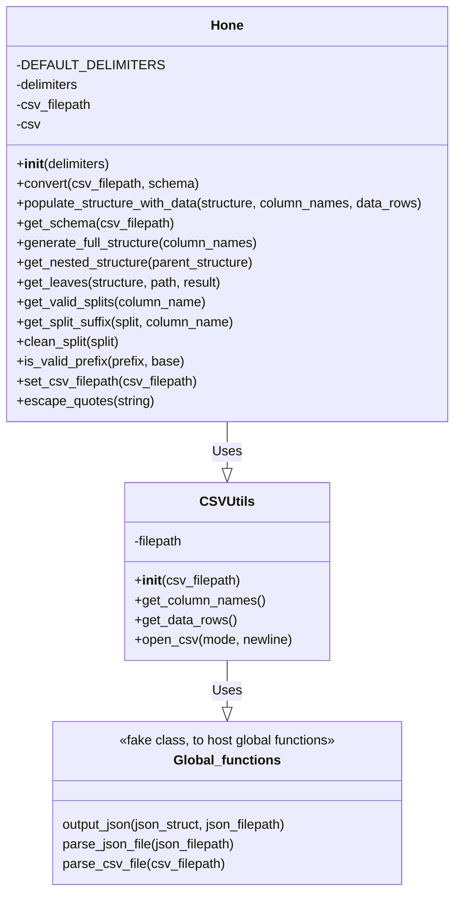

# Pack 11 — sdd/specs/UML_class.md · (root)
blocks 1 · nodes 1 (requirement 1) · AC labels: none

## Text

↳ N-000040 requirement · MUST · L2

## Claims to implement
- [N-000040] requirement · MUST · L2 — classDiagram
    class Global_functions {
        <<fake class, to host global functions>>
        output_json(json_struct, json_filepath)
        parse_json_file(json_filepath)
        parse_csv_file(csv_filepath)
    }
    
    class Hone {
        -DEFAULT_DELIMITERS
        -delimiters
        -csv_filepath
        -csv
        +__init__(delimiters)
        +convert(csv_filepath, schema)
        +populate_structure_with_data(structure, column_names, data_rows)
        +get_schema(csv_filepath)
        +generate_full_structure(column_names)
        +get_nested_structure(parent_structure)
        +get_leaves(structure, path, result)
        +get_valid_splits(column_name)
        +get_split_suffix(split, column_name)
        +clean_split(split)
        +is_valid_prefix(prefix, base)
        +set_csv_filepath(csv_filepath)
        +escape_quotes(string)
    }
    
    class CSVUtils {
        -filepath
        +__init__(csv_filepath)
        +get_column_names()
        +get_data_rows()
        +open_csv(mode, newline)
    }
    
    CSVUtils --|> Global_functions : Uses
    Hone --|> CSVUtils : Uses
  needs: none

## Acceptance criteria
None.

## Constraints in scope
plus the broad constraints in pack 01

## Related elsewhere
None.

## Conflicts
None.

## Terms
None.
