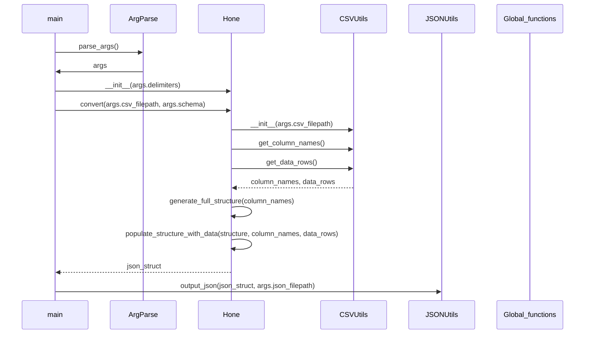

# Pack 12 — sdd/specs/UML_sequence.md · (root)
blocks 1 · nodes 1 (requirement 1) · AC labels: none

## Text

↳ N-000041 requirement · MUST · L2

## Claims to implement
- [N-000041] requirement · MUST · L2 — sequenceDiagram
    participant main
    participant ArgParse
    participant Hone
    participant CSVUtils
    participant JSONUtils
    participant Global_functions
    
    main->>ArgParse: parse_args()
    ArgParse->>main: args
    main->>Hone: __init__(args.delimiters)
    main->>Hone: convert(args.csv_filepath, args.schema)
    Hone->>CSVUtils: __init__(args.csv_filepath)
    Hone->>CSVUtils: get_column_names()
    Hone->>CSVUtils: get_data_rows()
    CSVUtils-->>Hone: column_names, data_rows
    Hone->>Hone: generate_full_structure(column_names)
    Hone->>Hone: populate_structure_with_data(structure, column_names, data_rows)
    Hone-->>main: json_struct
    main->>JSONUtils: output_json(json_struct, args.json_filepath)
  needs: N-000008 (pack 03), N-000013 (pack 03)

## Acceptance criteria
None.

## Constraints in scope
plus the broad constraints in pack 01

## Related elsewhere
- N-000041 refines N-000006 (pack 03)

## Conflicts
None.

## Terms
None.
