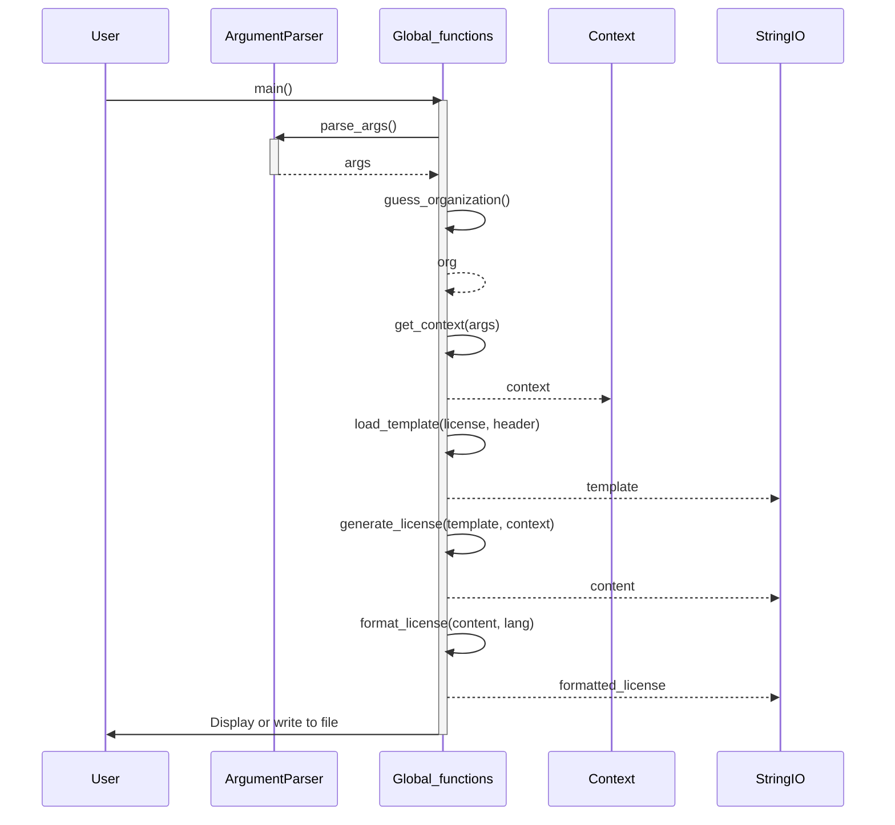

# Pack 15 — sdd/specs/UML_sequence.md · UML sequence
blocks 1 · nodes 1 (requirement 1) · AC labels: none

## Text
# UML sequence

↳ N-000041 requirement · MUST · L2

## Claims to implement
- [N-000041] requirement · MUST · L2 — sequenceDiagram
      participant User
      participant ArgumentParser
      participant Global_functions
      participant Context
      participant StringIO
    
      User->>Global_functions: main()
      activate Global_functions
    
      Global_functions->>ArgumentParser: parse_args()
      activate ArgumentParser
      ArgumentParser-->>Global_functions: args
      deactivate ArgumentParser
    
      Global_functions->>Global_functions: guess_organization()
      Global_functions-->>Global_functions: org
      Global_functions->>Global_functions: get_context(args)
      Global_functions-->>Context: context
      Global_functions->>Global_functions: load_template(license, header)
      Global_functions-->>StringIO: template
    
      Global_functions->>Global_functions: generate_license(template, context)
      Global_functions-->>StringIO: content
    
      Global_functions->>Global_functions: format_license(content, lang)
      Global_functions-->>StringIO: formatted_license
    
      Global_functions->>User: Display or write to file
      deactivate Global_functions
  needs: none

## Acceptance criteria
None.

## Constraints in scope
plus the broad constraints in pack 01

## Related elsewhere
None.

## Conflicts
None.

## Terms
None.
