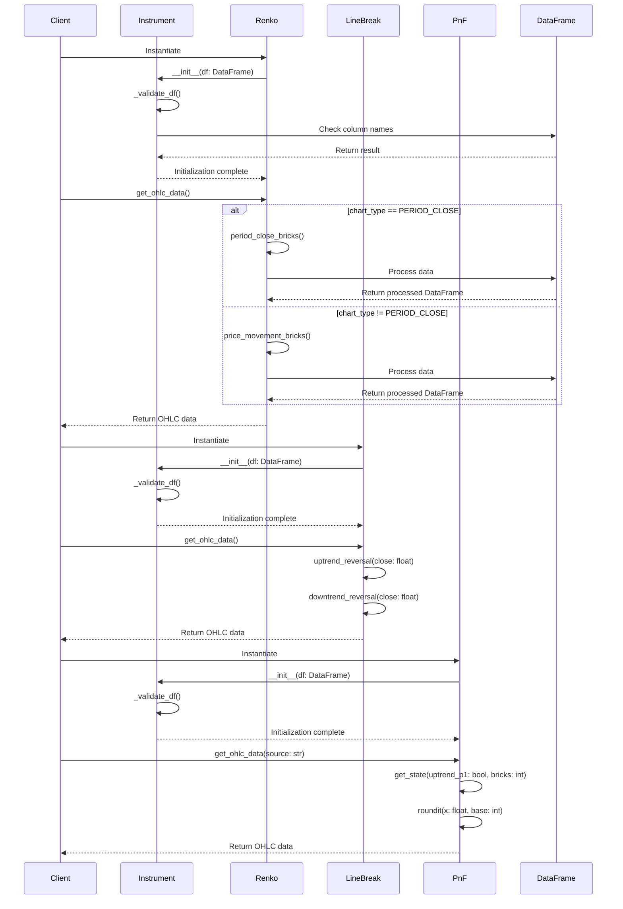

# Pack 11 — sdd/specs/UML_sequence.md · UML sequence
blocks 1 · nodes 1 (requirement 1) · AC labels: none

## Text
# UML sequence

↳ N-000046 requirement · MUST · L2

## Claims to implement
- [N-000046] requirement · MUST · L2 — sequenceDiagram
        participant Client
        participant Instrument
        participant Renko
        participant LineBreak
        participant PnF
        participant DataFrame
    
        Client->>Renko: Instantiate
        Renko->>Instrument: __init__(df: DataFrame)
        Instrument->>Instrument: _validate_df()
        Instrument->>DataFrame: Check column names
        DataFrame-->>Instrument: Return result
        Instrument-->>Renko: Initialization complete
    
        Client->>Renko: get_ohlc_data()
        alt chart_type == PERIOD_CLOSE
            Renko->>Renko: period_close_bricks()
            Renko->>DataFrame: Process data
            DataFrame-->>Renko: Return processed DataFrame
        else chart_type != PERIOD_CLOSE
            Renko->>Renko: price_movement_bricks()
            Renko->>DataFrame: Process data
            DataFrame-->>Renko: Return processed DataFrame
        end
        Renko-->>Client: Return OHLC data
    
        Client->>LineBreak: Instantiate
        LineBreak->>Instrument: __init__(df: DataFrame)
        Instrument->>Instrument: _validate_df()
        Instrument-->>LineBreak: Initialization complete
    
        Client->>LineBreak: get_ohlc_data()
        LineBreak->>LineBreak: uptrend_reversal(close: float)
        LineBreak->>LineBreak: downtrend_reversal(close: float)
        LineBreak-->>Client: Return OHLC data
    
        Client->>PnF: Instantiate
        PnF->>Instrument: __init__(df: DataFrame)
        Instrument->>Instrument: _validate_df()
        Instrument-->>PnF: Initialization complete
    
        Client->>PnF: get_ohlc_data(source: str)
        PnF->>PnF: get_state(uptrend_p1: bool, bricks: int)
        PnF->>PnF: roundit(x: float, base: int)
        PnF-->>Client: Return OHLC data
  needs: none

## Acceptance criteria
None.

## Constraints in scope
plus the broad constraints in pack 01

## Related elsewhere
- N-000050 refines N-000046 (pack 12)

## Conflicts
None.

## Terms
None.
