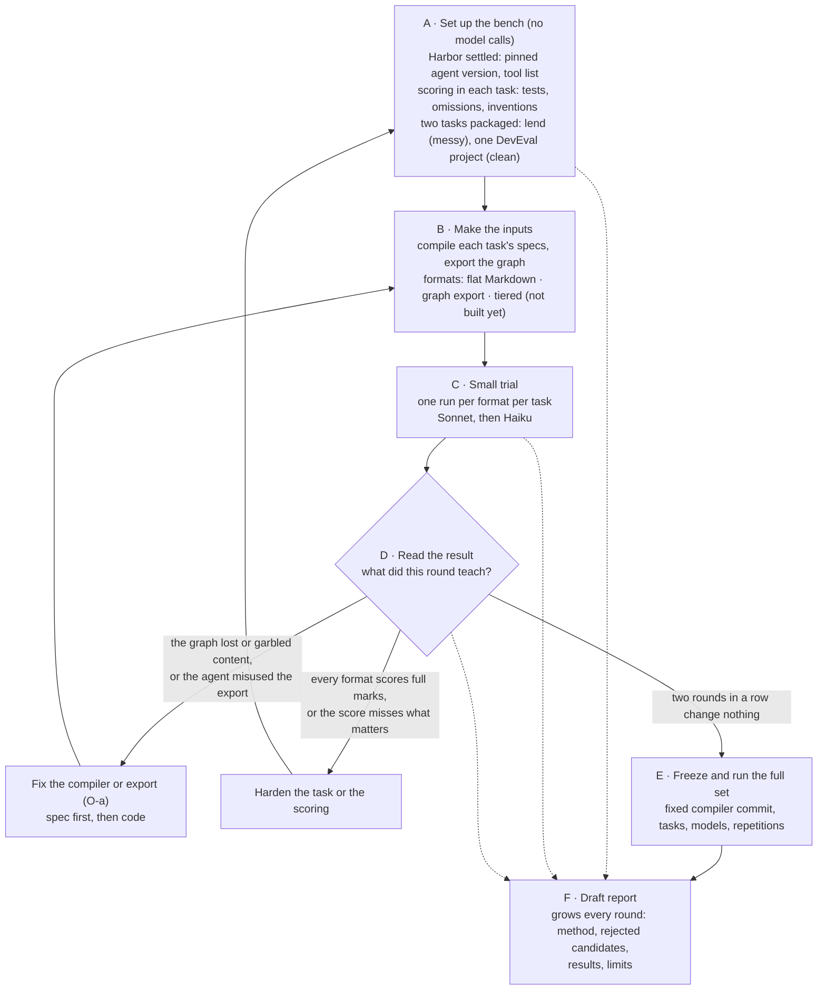

# Release 02 — Brainstorm & Decisions

> **SDD role:** `design/` tier — NON-AUTHORITATIVE. Do not code from this file. Ideas graduate into
> a spec once acceptance criteria can be written. If this file and a spec disagree, the spec wins.
>
> **Status:** OPEN · **Opened:** 2026-10-11 · **Target close:** *not set* ·
> **Branch:** `rel-02-graph-for-code-gen-test` ·
> **Previous release:** [rel01 close-out](../releases/rel01_closeout.md) ·
> [rel01 archive](../../archive/rel-01/README.md) (FROZEN)

---

## Release goal

Two objectives, set by the owner (rel02 D1):

- **O-a — the compiled graph is ready for an AI coding agent to generate code from.** Context: product.
  *What "ready" means, as a measured pass line, is open (Q1).* rel01 closed on a weaker form of this
  (rel01 D35/D42: one clean task, both formats 26 / 26, so the formats were not told apart).
- **O-b — the detailed plan of the master's course project** (the study that compares specification
  formats). Context: course project. Its planning documents live in this folder (rel02 D2).

## Carried over from rel01

From the close-out's "What did not ship" table and the archived build plan §8. No order is implied;
ranking is Q2.

| Item | Evidence (source) |
|---|---|
| I-93 conflict precision | 1 real of 381 (0.26 %) against a pass line of ≥ 25 %; nine false-positive shapes named (close-out; build-plan §8) |
| I-94 atomization failures | 8 blocks fail on every retry (close-out) |
| Cost and time of a compile | 2 673 calls, ≈ $54.94 est. API-equivalent, 9.05 h for 845 blocks (close-out; M4-gate §8) |
| I-95, I-96 export size and order | 2.94× the Markdown's characters; build order breaks 42 of 151 cross-spec `depends_on` links (close-out) |
| I-65, I-76 term proliferation | ≈ 67 % one-node families (close-out) |
| I-92 fidelity | Coverage of the pilot graph *not measured* |
| Deferred commands and tests | `query`, `map`, `check`, `review accept/reject`, `pairs --exhaustive`; tests for F3 AC-3.21/3.22 (close-out) |
| Live editing, hooks, AI fix loop | Withdrawn from rel01 (rel01 D26): D13, D16, D18, D25 |
| Messy pilot task `lend` | Built, checked 24 / 24 on its reference, not compiled; `harness/tasks/lend-messy/DESIGN.md` |
| Harness has no governing spec | `harness/` has no entry in `sdd/specs/ownership.yaml` |

## Scope

*To be written.*

## Plan

### Words used in this plan

| Word | Meaning | In this project |
|---|---|---|
| **Benchmark** | A set of tasks with their answers: for each task, a specification to build from and a way to tell whether the result is right (tests or a judge) | Candidates: ProjectEval, RealBench, Doc2Feat-Bench. Our own tasks: `f1-ingest`, `lend-messy` |
| **Platform** | The machinery that runs an agent on a task and records what happened (time, cost, tokens, pass or fail). It has no tasks of its own | Ours: `harness/`. Candidate: Harbor |
| **Metric** | The number computed from a run | Hidden tests passed, requirements omitted, things invented, time, cost, tokens |

ProjectEval and RealBench are named in the proposal both as benchmarks and as platforms because each
ships its tasks **together with** its own runner and judge. Harbor is a platform only. Doc2Feat-Bench
was listed only as a benchmark; whether it ships a runner is *not checked*.

### Milestones for the study (O-b), working backwards (rel02 D5) — ACCEPTED (rel02 D6)

Progress against these steps is kept in [`rel02_build_progress.md`](rel02_build_progress.md).

No dates (rel02 D3). Each step is finished when its "done when" holds. The compiler work of O-a hangs
off step 5: it is whatever the benchmark's specifications show to be missing.

| # | Step | Done when | Spends model calls? | State |
|---|---|---|---|---|
| 1 | Try the candidate benchmarks | For each candidate: one task opened, licence read, its scorer run once on any output, one number printed — or the reason it cannot be | No (unless a benchmark's judge is itself a model) | Not started; only abstracts and READMEs read |
| 2 | Choose benchmark, platform, metrics | Decision recorded here, with what each rejected option lacked | No | Open (Q1, Q6) |
| 3 | Fix the measuring | Each metric has a written definition and a script or an audit rule; statistics and repetitions written down before any reported run | No | Open (Q4). Draft commitments dropped from the submitted proposal are listed in `project-proposal.md` |
| 4 | Prepare the tasks | Every task has a specification, a requirement list, and tests or a judge that pass on a reference and fail on a no-op | No | `f1-ingest` and `lend-messy` exist; benchmark tasks: none |
| 5 | Render three formats | Flat, tiered and graph exist for every task; the parity check passes; compile cost recorded | **Yes** (compile) | Tiered and graph for `f1-ingest`; `lend` not compiled; flat format and parity check not built |
| 6 | Pilot | One run per format per model scored end to end; cost and time per run measured | **Yes** | F1 pilot done for Sonnet, two formats (both 26 / 26: no discrimination) |
| 7 | Decide and freeze | Models, repetitions and run count fixed from the measured cost; compiler commit, tasks and harness recorded | No | — |
| 8 | Main runs | Every planned run has a `run.json`; aborted runs are kept and named | **Yes** | — |
| 9 | Score and audit | Every run scored; audit sample labelled blind to format; agreement reported | No (unless a model judge is used for triage) | — |
| 10 | Analyse | Main table and intervals computed from the stored runs by a script | No | — |

Every step that spends model calls needs the owner's approval first.

### Working map for quick iteration (rel02 D14) — ACCEPTED 2026-10-12 (rel02 D15)

A short map of the whole job, for orientation. It does not replace the ten steps above: it groups them
into a loop that can be gone round several times with small trials. Platform, benchmark and task
sources are decided (D13).

| Stage | What it is | Model calls? | State on 2026-10-12 |
|---|---|---|---|
| A · Set up the bench | Harbor ready for repeatable runs; each task scores tests, omissions and inventions; reference scores full marks and a do-nothing agent scores zero | No | **Round 1 done for `lend` (2026-10-12):** omissions, contradiction sides, extra commands and an audit triage are scored; agent version pinned in the image; tools and network limited. Three items wait for the first model run to confirm. `hone` still scores tests only |
| B · Make the inputs | Compile and export each task's specifications; build the tiered format | **Yes** (compile) | `hone` and `lend` compiled and exported; tiered not built |
| C · Small trial | One run per format per task, one model at a time | **Yes** | Sonnet, all full marks: `hone` both formats; `lend` both formats under round 1 conditions (round 2) |
| D · Read the result | Decide which arrow to follow, and write down why | No | First reading done (S3): Sonnet is at the ceiling |
| E · Freeze and run | Fix everything, then run the repetitions | **Yes** | — |
| F · Draft report | Written alongside, not at the end | No | Not started; method and rejected candidates can be written now |

**What "ready for code generation" (O-a) means on this map — the initial pass line, accepted by the
owner (D15, Q1):** on the messy task, an agent given the graph export meets at least as many requirements as one
given the Markdown, with no more inventions, and the loop from D back to B has stopped finding export
defects. The numbers behind "at least" are *to be set* once stage A can score omissions and
inventions.

**Suggested first three rounds** (each needs the owner's go-ahead where it spends model calls):

1. **Stage A, no model calls.** Port omission and invention scoring for `lend` into Harbor; pin the
   agent version; restrict the tool list. Without this no later round can show a difference.
2. **Stage B then C on the messy task.** Compile `lend` (estimated, not measured: ≈ $5.5 and ≈ 270
   calls), then one run per format on Sonnet. This is the first test of the product's claim.
3. **Stage C on Haiku,** the same runs, to see whether a weaker model leaves room between formats.

**Rules that keep trial-and-error cheap:**

- Free checks before paid ones: the reference and do-nothing agents must give full marks and zero
  before any model run on a task.
- Change one thing per round, so a changed result has one cause.
- One run is an observation, not a result. Repetitions come at stage E.
- Compare only runs made with the same compiler commit, task version and agent version.
- Every run is kept and logged, including failed and aborted ones.
- A round that changes the compiler goes spec first, as the working agreement requires.

## Risks

- **The compiler is the thing the study tests.** If O-a changes the compiler while study runs are being
  made, runs made before and after a change cannot be compared. The compiler version (commit) must be
  fixed and recorded for any set of runs that is reported together.
- **O-a without a pass line slips**, as rel01 did (rel01 D35).

---

## Sessions

### S1 — 2026-10-11 — rel02 opened

- rel01 archived to `sdd/archive/rel-01/`; `main` holds rel01 as one commit; this branch starts from it.
- `harness/` moved to the repository root, with its tasks in `harness/tasks/` (was
  `docs/MIA5150-Project/`). Checked: 754 tests pass; `run_task.py --dry-run` on `lend-messy` reports
  every sandbox probe `ok` (no model call).
- The submitted proposal is mirrored in `docs/MIA5150-Project/project-proposal/project-proposal.md`;
  what the submission dropped from the earlier draft is listed at the end of that file.
- Owner set D1–D3.

### S2 — 2026-10-12 — backwards plan accepted; milestone 1 set up

- Owner: work backwards from benchmark and metrics (D5); ten milestones accepted (D6); every trial
  recorded for the report (D7).
- Explained for the owner: `lend` is a home-made task (specification plus its answer sheet), not a
  benchmark; a benchmark is tasks with answers, a platform runs and records.
- Made `harness/benchmarks/{projecteval,realbench,doc2feat-bench}/` and `harness/platforms/harbor/`,
  each with a `TRIAL.md`; made `rel02_build_progress.md` with the trial queue.
- Re-read the proposal and the survey for missed candidates: four listed for the owner (Q7).
- Owner added the four extras (D8).
- **Trial 1, ProjectEval, done.** Finding: its specifications are a sentence or a short checklist
  (median 14 and 179.5 words), so there is nothing to render three ways; its judge runs without a
  model but needed five fixes on Linux and gives its own reference answer 202 / 284. Recommended:
  not the main benchmark. Record: `harness/benchmarks/projecteval/TRIAL.md`.
- Lesson for the next trials: check the **size and shape of the specification first**, before any
  install; it decides fit faster than the judge does.
- **Trial 2, Harbor, done in part.** It cannot run here: it needs a container runtime and this machine
  has none. Read from its code: it supports the subscription (a token from `claude setup-token`, no API
  key) and records time, cost and tokens per trial. Recommended: keep our own `harness/` for now.
  Record: `harness/platforms/harbor/TRIAL.md`.
- New open question Q8 (Docker), which touches several candidates, not only Harbor.
- **Owner installed Docker (D9); Harbor retried.** `lend` packaged as a Harbor task by a script: the
  reference scores 24 / 24, a do-nothing agent 0 / 24, the hidden tests are not visible to the agent,
  and several named rewards are reported per trial. Recommendation changed to: **Harbor fits**; adopt
  it if one subscription run succeeds (needs a token and the owner's approval — Q9).
- **That run was made (owner's token and approval).** Sonnet, `lend` Markdown: 24 / 24, $0.18 est.,
  6 turns, 3 min 5 s of which 95 s installing Claude Code. No API key used; token not in the job
  files. Recommendation: **adopt Harbor**. To settle before the main runs: cache or pin the Claude Code
  install, restrict the tool list (Harbor's default includes web tools), compare numbers with
  `harness/`. Warning for milestone 3: 24 / 24 from plain Markdown in 6 turns suggests the hidden
  tests alone may not separate the formats on this task (n = 1).
- **Harbor brings no fitting benchmark of its own.** Its registry lists 80 datasets; none is one of
  our six candidates by name. One near match, `deveval`, says it was "originally named DevBench" and
  gives PRDs, UML and architecture designs as input: a lead for trial 8, which should perhaps move up
  the queue (owner's call).
- **Trial 3, Doc2Feat-Bench, done (no model).** Its input is a documentation diff, median 132 words in
  one file, and the task edits a large existing project. Its evaluator worked first time. Recommended:
  reject as the main benchmark; reasons in `harness/benchmarks/doc2feat-bench/TRIAL.md` §5.
- **Pattern after three trials:** two public benchmarks, both rejected for the same reason: the
  specification is too small for its arrangement to matter. The study needs large, multi-file
  specifications; so far only our own `lend` has them.
- **DevEval (DevBench 2024) tried, moved up by the owner.** First public candidate with a real
  specification: four documents per project (PRD, class and sequence diagrams, architecture design),
  median 1 274 words, 21 projects, scored by tests, already a Harbor dataset. Two problems: the Harbor
  packaging leaves the answer, the tests and most of the code readable by the agent, so we would have
  to repackage it; and the documents are clean, with no conflicts, so the formats may not differ on
  it. Recommended: keep as the leading public candidate. A pilot on one repackaged project is the only
  way to know whether the formats separate (model calls; not approved yet).
- Next: trial 3, Doc2Feat-Bench — specification size and shape first.

---

### S3 — 2026-10-12 — milestone 1 finished: all eight candidates tried

Each candidate's full record is its `TRIAL.md` under `harness/benchmarks/` or `harness/platforms/`.
Every verdict below is a **recommendation**; the choice is the owner's (Q6).

**Benchmarks**

| Candidate | What the agent is given | Size of that input | Scoring worked here? | Recommended |
|---|---|---|---|---|
| ProjectEval | One sentence, or a checklist | Median 14 words / 179.5 words | After 5 fixes; its own answer scored 202 / 284 | Reject |
| Doc2Feat-Bench | A documentation diff + a large existing codebase | Median 132 words, 1 file | Yes, first attempt (1 / 1) | Reject |
| RealBench | Requirements + UML (per the paper) | Not reported | **Not obtainable** | Reject |
| RepoGenesis | One README (an API contract) | Median 634.5 words | Runs, but an empty folder scored Pass@1 = 1.0 on the task tried | Reject; borrow its API-coverage idea |
| ProgramBench | README + manual page + a runnable binary | 812 words on the one task seen | Evaluator not run | Reject |
| SWE-Dev *(added after the first eight, D12)* | One PRD of per-function docstrings + an existing package with those functions removed | Median 875 words (easy), 1 109.5 (hard), 1 file | Yes (9 / 9 vs 0 / 9); failed silently on 1 of 3 images | Reject |
| **DevEval (DevBench 2024)** | PRD + 2 UML diagrams + architecture design | **Median 1 274 words, 4 files** | Yes, after our clean repackaging (12 / 12 vs 0 / 12) | **Keep as the public benchmark, repackaged** |
| *our `lend`* (not a benchmark) | 7 messy files with 12 planted problems | 2 120 words | Yes (24 / 24 vs 0 / 24) | Keep as the task built to separate formats |

**Platforms**

| Candidate | Result | Recommended |
|---|---|---|
| Harbor | Runs our tasks and DevEval; Claude Code on the subscription works; hidden tests hidden; cost from Claude Code's own figure | **Adopt** |
| Inspect AI | Installed, code read, nothing run. Re-routes Claude Code's model calls through its own client | Do not adopt |
| `harness/` (ours) | Used for the F1 pilot | Keep as fallback and cross-check |

Platform trials in full — how far each went, a criterion-by-criterion comparison, what the choice
drops, and an eight-step plan — are in [`rel02_platform_comparison.md`](rel02_platform_comparison.md).
Two more outside runners were named in the proposal and are covered there: ProjectEval's judge and
RealBench's pipeline. Six tools from the survey were ruled out on documentation and never tried.

**The DevEval pilot** (owner approved; `harness/benchmarks/devbench-2024/TRIAL.md` §7). One project
(`python-hone`) repackaged without the leak, compiled (61 nodes, 3 duplications, no contradiction,
$0.2685 est.), one Sonnet run per format: **Markdown 12 / 12 in 4 turns ($0.1171 est.); graph export
12 / 12 in 11 turns ($0.1874 est.)**. n = 1 per arm.

**What three model runs now say, taken together** (`lend` Markdown 24 / 24; `hone` Markdown 12 / 12;
`hone` export 12 / 12):

1. **Sonnet is at the ceiling on every task we have,** from plain Markdown. Tests-passed cannot show a
   benefit of the graph on these tasks with this model.
2. **On a small, clean specification the export is the more expensive input** (5.5 times the words,
   1.6 times the cost in one run), and the compile is extra. If that holds, the honest finding of the
   study may be "no gain, higher cost" for clean specifications. That is a result, but the proposal
   expects a gain.
3. **No public benchmark has messy specifications.** DevEval's are clean: the compiler found no
   contradiction. The product's premise — consolidating conflicting, scattered specifications — is
   exercised only by `lend`, where the measures that could show it (omissions, inventions, the six
   audit items) are not scored on Harbor yet.

**Recommendation for milestone 2** (the owner decides):

- **Platform: Harbor.**
- **Tasks: two arms.** (a) `lend` and more home-made tasks like it, where the specification is messy by
  design: the arm that tests the product's claim. (b) DevEval, repackaged, as the public,
  clean-specification arm: it gives the report a named benchmark and an honest control ("when the
  specification is already clean, does the graph help or cost?").
- **Before anything else, milestone 3 must fix the measure.** Port the omission, invention and audit
  scoring of `lend` into Harbor's `test.sh`, because tests-passed is at the ceiling.
- **Then one cheap check of the ceiling:** the same three runs on Haiku. If Haiku is also at the
  ceiling, the tasks are too easy and must grow before the main runs.

**What this recommendation drops:** every other public benchmark; comparability with published DevEval
numbers (our repackaging changes the task); the proposal's claim that ProjectEval, RealBench or
Doc2Feat-Bench would supply the tasks — the report must say they were tried and why they were rejected.

### S4 — 2026-10-12 — round 1: the bench can now score more than tests (no model call)

- `lend` on Harbor reports 14 named numbers per run: tests, requirements met, omissions, the side
  taken on each of the five planted contradictions (A, B or neither), extra commands, and a keyword
  triage of the six audit items. Reference agent: 24 met, 0 omissions, 5 × A. Do-nothing agent: 0 met,
  24 omissions. The scorer is checked against three variants of the reference with known behaviour.
- Claude Code 2.1.296 is installed in the task image. With 19 tools disallowed it offers only `Bash`,
  `Edit`, `Read`, `Write` (seen without credentials). In the agent phase only the model API and PyPI
  are reachable; `example.com` and `github.com` were blocked.
- To confirm in the first model run: Harbor skips its install with the pinned version; the tool list
  when logged in; Claude Code works behind the allow-list.
- Limits: the invention count is partial; the triage is not the audit; `hone` (DevEval) still scores
  tests only. Record: `harness/platforms/harbor/TRIAL.md` §5a.
- Next is round 2: compile `lend` (model calls; estimate ≈ $5.5 and ≈ 270 calls, not measured; the
  profile's cap is 200 calls per run), then one Sonnet run per format.

### S5 — 2026-10-13 — round 2: the messy task, both formats, Sonnet (n = 1 each)

- **Compile of `lend`:** 98 calls, $0.5031 est., 37 min 34 s, far under the ≈ $5.5 and ≈ 270 calls
  estimated from rel01's per-block figures. 124 nodes, 12 conflicts. Export 13 516 words, 6.4 times
  the Markdown.
- **Compiler against the answer key:** found 5 of the 9 planted items it could detect; missed the fee
  cap ($10 / $15), the "patron" alias, the superseded limit (5 / 3) and the worked example. One of the
  12 conflicts reads as false. *(Assistant's reading; not audited.)*
- **Agent runs:** Markdown and export both 24 / 24, 0 omissions, identical sides on all five
  contradictions, no invented behaviour. Export: 6 turns and $0.2351 against 5 turns and $0.1451.
- **Against the pass line (D15):** "at least as many requirements, no more inventions" holds in this
  one pair. "The loop has stopped finding export defects" does not: the compiler missed four planted
  items, and the export agent's notes miss one of those four.
- **What the round taught about the bench:** tests and contradiction probes are at the ceiling for
  Sonnet on this task too. The only place the formats differed was the agents' notes, which need a
  human audit; our keyword triage was wrong on first contact and was fixed.
- **Arrows open on the working map** (owner's choice): fix the compiler's misses (O-a, spec first);
  harden the task or the scoring; or run round 3 on Haiku to see whether a weaker model separates.
  Record: `harness/platforms/harbor/TRIAL.md` §5b.

### S6 — 2026-10-13 — round 3 (Haiku) and what three rounds say

- **Round 3:** `lend` on Haiku, both formats: 24 / 24, 0 omissions, same side on every contradiction.
  Export $0.1118 against $0.0539. Record: `harness/platforms/harbor/TRIAL.md` §5c.
- **Across four runs on `lend` (2 models × 2 formats):** no scored difference at all. The export
  costs 1.6 to 2.1 times more to run, plus $0.50 to compile.
- **Why the task cannot separate the formats** (the assistant's analysis):
  1. *It is small.* 2 120 words: either model reads all seven files and holds them at once. Nothing
     is far enough apart to be lost.
  2. *The tests avoid the contradictions,* and the contradictions are unsettled in both formats. What
     the graph adds is a flag on a conflict; no test can register it.
  3. *The agents find the problems unaided.* Both models named four of the five contradictions from
     plain Markdown.
- **Defects in our own materials:** P1 is not a real contradiction; two scorer defects fixed.
- **Options for round 4, hardening the task** (owner's choice; none spends model calls to design):
  - **(a) Settle the contradictions and test the settled values.** The owner gives a verdict on each
    conflict the compiler reports; the export carries the verdicts; hidden tests check the settled
    behaviour. This measures the product's actual workflow: compile, a person settles, the agent
    builds. *Fairness question to decide:* the Markdown agent gets no verdicts, so the comparison is
    "raw specification" against "specification after the compiler and a person". That is the
    product's claim, but it must be stated as such.
  - **(b) Make the specification large.** Many more files and words, so the agent cannot hold
    everything and scattered rules can be missed. Tests the "scattered refinement" half of the
    hypothesis. Costs more to write and to compile.
  - **(c) Keep the task; add the blind audit of the notes** as the measure. Cheapest, but the audit
    has differed by at most one item so far.
  - **(d) Stop here and report the null result** on small specifications.
  The assistant's recommendation: (a) first, on the existing `lend` with P1 repaired, because it is
  small, quick, and aims at the one thing the graph adds; (b) next if (a) shows a difference worth
  scaling.

### S7 — 2026-10-13 — round 4: the owner's verdicts reach the code

- **Done (D16):** the owner settled the two contradictions the compiler reported (P2: overdue from
  the day after; P3: email in each report row), both opposite to what agents chose unaided. Verdicts
  recorded with `sddc conflicts judge`, export made without `--allow-open`, one run each on Sonnet and
  Haiku. Markdown runs of rounds 2 and 3 rescored, not rerun.
- **Result:** settled export 2 of 2 verdicts followed on both models; Markdown and unsettled export 0
  of 2. Tests 24 / 24 in every build. Detail: `harness/platforms/harbor/TRIAL.md` §5d.
- **Reading:** the workflow compile → judge → export → build works. This is the first scored
  difference in four rounds, but it is a difference of information (two decisions), not of format.
- **Export findings to weigh for the compiler:** (1) `MAP.md` is silent on settled conflicts and its
  "0 unsettled" can read as "no contradictions"; (2) which side wins is only in a free-text note and
  the losing claim stays an ordinary checklist item; (3) one decision needs several conflict records.
- **Still true from S6:** on a spec this small the formats do not differ in tests or omissions, and
  the export costs more to run.
- **Options for round 5:** (a) the control: Markdown plus the two decisions in a plain file, on both
  models (2 runs) — tells whether the graph adds anything beyond carrying the decision; (b) a larger
  spec, where scattered rules can be missed (new task, new compile); (c) fix the three export
  findings first (compiler work, spec-first, no model runs for the trial); (d) move to DevEval set-up
  (stage A for the public benchmark). Suggested: (a) now because it is cheap and a reviewer will ask
  for it, then (b).

### S8 — 2026-10-13 — round 5: the control, and what five rounds say about `lend`

- **Done (D17):** Markdown plus the two decisions in a plain `spec/DECISIONS.md`, one run each on
  Sonnet and Haiku.
- **Result:** 2 of 2 verdicts followed on both models, 24 / 24, at 0.58 times (Sonnet) and 0.31
  times (Haiku) the run cost of the settled export. Detail: `harness/platforms/harbor/TRIAL.md` §5e.
- **Reading:** the round 4 difference came from the decisions, not from the graph. On `lend` no
  scored measure favours the export in any of the 8 agent runs of rounds 2–5; it costs more in every pairing.
- **What is left for the graph to show:** (1) scale: a spec too large to hold at once, where
  scattered rules and a far-away decision can be missed; (2) the compiler's upstream value: finding
  the contradictions for the person to settle. On `lend` it found 2 of the 4 real ones, and the
  Markdown agents named one (Sonnet) or both (Haiku) of the other two unaided, by keyword triage of
  their notes, so a model reading the Markdown is itself a competing detector.
- **Against the pass line (D15):** "at least as many requirements, no more inventions" holds;
  "better" is not shown, and cost is worse. The pass line says nothing about cost; to revisit.
- **Options for round 6:** (a) a larger messy spec built to stress scale (new task, new compile;
  the one remaining place the hypothesis can win); (b) move to DevEval set-up, where specs are
  larger and public, and take the scale answer from there; (c) fix the three export findings of S7;
  (d) write up the small-spec null result now as a draft section. Suggested: (b) with (d) alongside:
  DevEval is needed for the report anyway and gives scale without writing a new task; (d) costs no
  model calls and fixes the wording while the detail is fresh.

### S9 — 2026-10-13 — round 6: DevEval is ready to run; the small-spec result is drafted

- **Done (D18), no model call:** the nine Python projects of DevEval repackaged as clean Harbor tasks
  under the `lend` conditions; 8 usable (123 hidden tests), `hybrid-images` left out because its
  reference fails under today's NumPy. Detail: `harness/benchmarks/devbench-2024/TRIAL.md` §8.
- **Correction to S8:** DevEval does **not** give larger specifications. All eight are smaller than
  `lend` (524 to 1 699 words against 2 120). DevEval serves the report as the well-known public
  benchmark; it cannot answer the scale question. That needs our own larger task.
- **Draft:** `rel02_report_draft.md` §R1, the result on `lend` (8 runs, four inputs, two models).
- **What to expect from DevEval:** the hone pilot was at the ceiling on Sonnet in both formats, and
  these specifications are clean. A weaker model may leave room; contradictions are not expected.
- **Options for round 7:** (a) DevEval on Haiku: compile the 7 other specifications (hone is done),
  then one run per format per project, 16 runs; (b) the same on 3 projects first (lice, arxiv-digest,
  stocktrends: the largest test sets), 6 runs and 3 compiles; (c) build the larger messy task of our
  own, the only place left where the graph can show an advantage; (d) fix the three export findings
  of S7. Suggested: (b), then decide between (a) and (c) on what it shows.

### S10 — 2026-10-13 — round 7: DevEval with Haiku is below the ceiling

- **Done (D19):** three compiles ($0.7067 est., 144 calls), exports, export tasks; 4 of 6 Haiku runs.
  The `stocktrends` pair was stopped by the system for low memory and not restarted.
- **Result:** `lice` 3 / 31 in both formats; `arxiv-digest` Markdown 22 / 42, export 30 / 42. Detail:
  `harness/benchmarks/devbench-2024/TRIAL.md` §9.
- **Reading:** this is the first setting where the agent is not at full marks, so it is the first
  where a format difference could show. One project shows none (the same omitted name in both), one
  shows 8 tests in favour of the export, at n = 1. Nothing can be concluded yet; it is worth
  repeating.
- **The compiler reported 2 contradictions in a public specification** (`arxiv-digest`), both real
  on reading. A small point for the report: the clean benchmark is not perfectly clean.
- **Measure:** tests-passed is brittle here (one missing name costs 25 tests).
- **Options for round 8:** (a) rerun the `stocktrends` pair, one run at a time (2 runs);
  (b) repeat `lice` and `arxiv-digest` to n = 3 per format (8 more runs, about $0.2 est. at the
  costs seen) to see whether the 8-test difference holds; (c) trace the 8-test difference to
  specification statements by reading the two builds (no model call); (d) extend to the other five
  projects (4 compiles, hone is done; 10 runs). Suggested: (a) and (c) now, then (b).

### S11 — 2026-10-13 — round 8: third project, and a scorer fault

- **Done (D20):** workspace saving added to the DevEval tasks; the `stocktrends` pair run one at a
  time on Haiku ($0.1672 est.).
- **Fault found and fixed:** the scorer counted tests the agents had written. First reward files
  8 / 9 and 7 / 9; on the hidden tests both builds pass 3 / 9. Round 7 numbers are not affected
  (collected counts checked). Detail: `harness/benchmarks/devbench-2024/TRIAL.md` §9.4.
- **Result over three projects, Haiku, n = 1:** `lice` 3 / 31 both; `arxiv-digest` 22 / 42 Markdown,
  30 / 42 export; `stocktrends` 3 / 9 both. The export run costs 2.2 to 3.9 times the Markdown run.
- **Reading:** two projects show no difference and in both the two builds fail the same tests. One
  shows 8 tests for the export, unrepeated. On `stocktrends` at least 2 of the 6 failed tests ask for
  things the specification does not state, so part of the DevEval score is agreement with the
  reference, out of reach of any input format.
- **Options for round 9:** (a) repeat `arxiv-digest` to n = 3 per format with workspace saving
  (4 more runs, about $0.08 est. at the costs seen), and read the code of the difference: the one
  place where a format effect may exist; (b) repeat all three projects to n = 3 (12 runs, about
  $0.5 est.); (c) no model: for the three projects, mark each hidden test as "stated in the
  specification" or "reference only", and score on the stated ones; (d) extend to the other five
  projects (4 compiles, 10 runs); (e) stop DevEval here and write it up as a second null result
  with one open observation. Suggested: (a) and (c), then decide between (d) and (e).

### S12 — 2026-10-13 — round 9: the difference shrinks, and DevEval's tests mostly test the reference

- **Done (D21):** `arxiv-digest` to n = 3 per format ($0.0685 est.); 82 hidden tests classified by
  reading. Detail: `harness/benchmarks/devbench-2024/TRIAL.md` §10.
- **Result 1:** Markdown 22, 27, 28; export 30, 30, 29 of 42. The first run's 8-test gap was mostly
  run-to-run variation. Two tests separate the formats in every run: the export builds apply the
  allowed-characters rule inside the function the tests call, the Markdown builds at the command
  line. The specification does not say where; the tests happen to want the former.
- **Result 2:** only 33 of 82 hidden tests are stated in the specification. 34 need something it
  does not give or contradict it, and no run passed any of them. All 25 `lice` unit tests are
  unreachable (they import a name absent from the specification).
- **Reading:** on DevEval with Haiku there is one small, steady difference for the export, on a
  point the specification leaves open, at 2.2 to 3.9 times the run cost. It is real enough to
  describe and too narrow to claim. The stronger finding for the report is about the benchmark:
  its raw score mostly measures agreement with a reference, so "clean public benchmark" does not
  give a clean measure of format.
- **Where this leaves the main question** (does the graph help code generation?): four settings
  tried (`lend` on two models, `hone` on Sonnet, three DevEval projects on Haiku); no difference on
  tests except the two above; the export always costs more; the one clear lever was the owner's
  decisions, which a plain file carried as well.
- **Options for round 10:** (a) write this up now: report sections for DevEval and for the overall
  null result, no model calls; (b) test the one place the graph has not been tried and should
  matter most: a specification too large to read at once (a new larger task of ours, one compile,
  2 to 4 runs); (c) widen DevEval to the other five projects, scored on stated tests only (4
  compiles, 10 runs, plus classification) to see whether the small difference appears elsewhere;
  (d) fix the three export defects of S7 in the compiler (spec-first, no trial runs). Suggested:
  (a) first, since the picture is now stable enough to write; then (b), the test that could still
  change the conclusion.

### S13 — 2026-10-13 — round 10: the results written down

- **Done (D22):** draft report sections R2 (DevEval) and R3 (overall) in `rel02_report_draft.md`.
  No model call.
- **What the overall table says:** six settings; no difference in tests passed in five, two tests
  for the export in the sixth; the export run costs 1.6 to 2.7 times the Markdown run; decisions
  reach the code through either carrier.
- **What writing it made plain:** the claim "the graph helps code generation" has no support at
  this size, and the one untested condition that could support it is a specification too large to
  read at once. The conflict report is the part with evidence behind it.
- **For the owner to weigh:** whether rel02's claim should shift from "better code" to "conflicts
  found and decisions carried before code is written", or whether the large-specification test
  comes first.
- **Options for round 11:** (a) the large-specification test: build one larger task of ours
  (several times `lend`, planted cross-file rules), compile once, run both formats on Haiku three
  times each; the costliest option (one compile likely several times the $0.50 of `lend`: *to be
  measured*) and the only one that can change the conclusion; (b) the human audit of the agents'
  notes on `lend` (owner's time, no model call): do agents given the export name more real
  contradictions and invent fewer?; (c) fix the three export defects in the compiler, spec-first;
  (d) repeat `lend` to n = 3 per cell (16 more runs, about $2 est. at the costs seen) to firm up
  R1. Suggested: (a), designed small first: agree the size and the planted rules before any spend.

## Decisions log

- **rel02 D1 — 2026-10-11 — rel02 has two objectives: O-a, the graph is ready for a coding agent to
  generate code; O-b, the detailed plan of the master's course project.** Owner.
- **rel02 D2 — 2026-10-11 — The study's planning is kept under `sdd/design/rel-02/`.** Owner. Rationale:
  the main repository holds all of the study's tests, tasks and benchmark. *Rejected:* keeping the plan
  under `docs/MIA5150-Project/`. Unchanged: `sdd/specs/vision.md` does not mention the course.
- **rel02 D3 — 2026-10-11 — The dates in the proposal's week-by-week plan are for reporting, not for
  scheduling the work.** Owner. *Assumed, to be confirmed:* the course's own deadlines (check-in 6 Nov,
  presentation, final report 4 Dec) are not changed by this.
- **rel02 D4 — 2026-10-11 — The harness and its tasks live at `harness/` and `harness/tasks/`, outside
  `docs/` and outside `src/`.** Owner. Rationale: they are code and test material, and F7 D9 keeps
  scoring out of the compiler. The task `lend` is kept for rel02.

- **rel02 D5 — 2026-10-12 — rel02 works backwards: first the test benchmark and the metrics, then how
  the compiler handles the specifications that benchmark gives.** Owner. Rationale: that is how
  "ready for code generation" (O-a, Q1) gets decided. Consequence: the benchmark and metrics are chosen
  before any compiler change; the home-made task `lend` is not a benchmark and does not set the pass line
  by itself.

- **rel02 D6 — 2026-10-12 — The ten milestones and their diagram are accepted; milestone 1 starts now.**
  Owner. Rationale: the chosen benchmark and platform settle many later design choices.
- **rel02 D7 — 2026-10-12 — Every benchmark or platform trial is written down, whether the candidate
  fits or not, with the method and the reason it was chosen or rejected.** Owner. Rationale: the final
  report needs them. Each candidate has a folder under `harness/benchmarks/` or `harness/platforms/`
  with a `TRIAL.md`; what it downloads goes in that folder's `download/`, which git ignores (third-party
  licences and sizes). The queue and its state are in `rel02_build_progress.md`.

- **rel02 D8 — 2026-10-12 — RepoGenesis, ProgramBench, Inspect AI and DevBench (2024) join the trial
  queue.** Owner; answers Q7. Eight candidates in all: six benchmarks, two platforms.

- **rel02 D9 — 2026-10-12 — Docker is installed on the study machine** (Docker Engine 29.9.0). Owner;
  answers Q8. Candidates that need a container are judged on fit, not rejected for the machine.

- **rel02 D10 — 2026-10-12 — DevBench/DevEval is tried before the rest of the queue.** Owner, on the
  lead found in Harbor's registry.
- **rel02 D11 — 2026-10-12 — The DevEval pilot is approved** (compile one project, one run per format),
  after the no-model trials of RealBench, RepoGenesis, ProgramBench and Inspect AI. Owner. Done the
  same day; result in S3.
- **rel02 D12 — 2026-10-12 — SWE-Dev (arXiv:2505.16975) joins the candidate list as the ninth.**
  Owner, who also asked how well known each platform and benchmark is, because a known name makes the
  report more credible. Tried the same day, no model: recommendation reject
  (`harness/benchmarks/swe-dev/TRIAL.md`). Popularity indicators and how to read them:
  `rel02_platform_comparison.md` §6.
- **rel02 D13 — 2026-10-12 — Harbor is the platform; DevEval is the public benchmark; the
  messy-specification tasks are our own.** Owner; answers Q6 and closes milestone 2 for platform and
  benchmark. The report states that the messy-specification tasks are our own because no public
  benchmark has them: nine candidates were tried and none has scattered, duplicated or contradictory
  specifications. Evidence: S3, `rel02_platform_comparison.md`, the nine `TRIAL.md` records.
  *What this drops:* every other candidate; Inspect AI's built-in error bars; comparability with
  published DevEval numbers, because we repackage its tasks to stop the leak; a headline result on a
  benchmark every reader knows. `harness/` stays as the cross-check. Metrics are not decided by this
  (Q1, Q4).
- **rel02 D14 — 2026-10-12 — rel02 works in quick iterations: decide, run a small trial, refine.**
  Owner. Reason, in the owner's words: "I have no idea of how a spec-graph is ready for code
  generation, no idea of using these testing benchmark, platform and the messy-spec tasks." So
  learning by small runs comes before fixed plans. How it is applied (the assistant's reading, to be
  corrected by the owner):
  - Each iteration is small: one question, the cheapest trial that answers it, the result written
    down, then the next decision.
  - A decision may be revised by a later iteration. The log keeps the old entry and marks it
    superseded; it is never rewritten.
  - The milestone list is a map, not a sequence to finish in order. Freezing the design (milestone 7)
    comes only when the iterations stop changing the answers.
  - Unchanged: every model call still needs the owner's go-ahead; no invented numbers; every trial,
    fit or unfit, is recorded (D7).
- **rel02 D15 — 2026-10-12 — The working map, the initial pass line for "ready for code generation",
  and the first three rounds are accepted.** Owner. Pass line (initial, may be refined by a later
  round): on the messy task, an agent given the graph export meets at least as many requirements as
  one given the Markdown, with no more inventions, and the loop has stopped finding export defects.
  Rounds: (1) stage A without model calls; (2) compile `lend`, then one run per format on Sonnet;
  (3) the same runs on Haiku. Each model-spending step is confirmed with the owner when it starts.
- **rel02 D16 — 2026-10-13 — Round 4 is option 1 of S6: settle the reported contradictions and score
  the settled behaviour.** Owner. Verdicts: P2 → `loans/spec.md` wins (overdue from the day after the
  due date); P3 → `ops/notes.md` wins (contact email in each report row). Two runs (settled export on
  Sonnet and on Haiku); the Markdown side reuses the round 2 and 3 runs. Accepted limit: Markdown
  carries no decisions, so this compares the workflow, not the format. Also: P1 is recorded as a
  loose bound, not a contradiction (`harness/tasks/lend-messy/ANSWER_KEY.md`).
- **rel02 D17 — 2026-10-13 — Round 5 is the control of S7 option (a):** Markdown plus the owner's two
  decisions in a plain file, one run each on Sonnet and Haiku. Owner.
- **rel02 D18 — 2026-10-13 — Round 6 is DevEval set-up plus a draft of the small-spec result.** Owner.
  No model calls.
- **rel02 D19 — 2026-10-13 — Round 7 is DevEval on three projects with Haiku** (S9 option b): `lice`,
  `arxiv-digest`, `stocktrends`; compile each specification, then one run per format per project (6
  runs). Owner. Also from the owner: the build progress, notes, decisions and options, and the
  methodology are to be recorded at every step, not only at the end of a round.
- **rel02 D20 — 2026-10-13 — Round 8 is option 1 of S10:** add workspace saving to the DevEval
  tasks, then rerun the `stocktrends` pair one run at a time. Owner.
- **rel02 D21 — 2026-10-13 — Round 9 is option 1 of S11:** repeat `arxiv-digest` to three runs per
  format with workspace saving, and classify the hidden tests of the three projects as stated in the
  specification or not. Owner.
- **rel02 D22 — 2026-10-13 — Round 10 is option 1 of S12:** write up the DevEval result and the
  overall result as draft report sections, no model calls. Owner.

## Rejected alternatives

## Open questions

- **Q1 — partly answered by D15:** an initial pass line is accepted; its numbers are still *to be set*.
  *(was)* **Q1 — What measured result means "ready for a coding agent" (O-a)?** Which task(s), which measures,
  what pass line. To be set by the owner before the run that tests it.
- **Q2 — In what order are the carried-over items worked?**
- **Q3 — Does the harness get a spec** (and an `ownership.yaml` entry) before it is changed?
- **Q4 — Which commitments dropped from the proposal draft does the study keep?** Run count
  (5 × 3 × 3 × 2 = 90 was the draft's design value), statistics, blind audit with agreement, parity check.
- ~~**Q6**~~ — answered by D13 (2026-10-12): Harbor; DevEval as the public benchmark; our own
  messy-specification tasks. *(was)* **Which benchmark, and whose scorer?** Whose scorer is still open:
  the recommendation is our own scoring inside each task's `test.sh` (see Q1, Q4).
- **Q10 — Approve the ceiling check?** Three Haiku runs (`lend` Markdown, `hone` Markdown, `hone`
  export) through Harbor, to learn whether a weaker model leaves room for the formats to differ. Cost
  *not measured*; the three Sonnet runs cost $0.18, $0.12 and $0.19 est. API-equivalent.
- **Q11 — Is "no gain, higher cost on clean specifications" an acceptable outcome to report,** or must
  the study be reshaped around messy specifications only? It changes which tasks are worth building.
- ~~**Q7**~~ — answered by D8: all four added.
- *(was Q7)* **Add candidates that the proposal does not name?** RepoGenesis, ProgramBench (benchmarks), Inspect
  AI (platform), DevBench 2024 (benchmark, never opened). Reasons for and against each are in
  `rel02_build_progress.md`. Trying one costs time, not model calls.
- ~~**Q9**~~ — answered 2026-10-12: approved and run. 24 / 24, $0.18 est. API-equivalent, 3 min 5 s
  (`harness/platforms/harbor/TRIAL.md` §3). Recommendation is now "adopt Harbor"; the choice itself is
  Q6, at milestone 2. *(was)* **Approve one Harbor run of `lend` (Markdown) with Claude Code on the subscription?** It is the
  last unknown before Harbor can be chosen or rejected. Needs a token from `claude setup-token` and one
  model run under a cost ceiling. Cost per run on this task is *not measured*; the only measured
  figures are the F1 pilot's ≈ $0.52 and ≈ $0.70 est. API-equivalent on Sonnet.
- ~~**Q8**~~ — answered by D9. *(was)* **Install Docker on the study machine?** Needed by Harbor, by ProjectEval's supported Linux route,
  and probably by other candidates. It needs administrator rights. Without it, those candidates are
  rejected for that reason, and the report says so. (`rel02_build_progress.md`, blocker B1.)
- **Q5 — Compile `lend` now?** ≈ $5.5 est. API-equivalent and ≈ 270 calls, *an estimate, not measured*
  (`harness/tasks/lend-messy/DESIGN.md`). Needs the owner's approval: it makes model calls.
