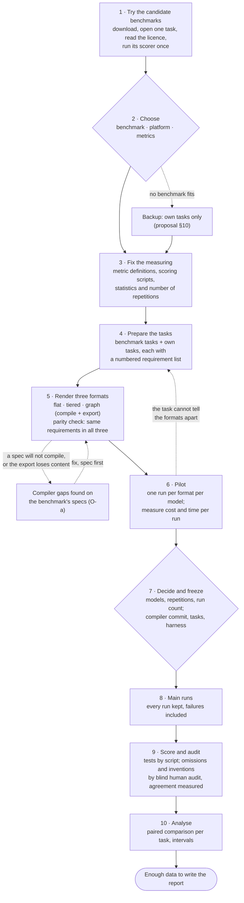

# Release 02 — Brainstorm & Decisions

> **SDD role:** `design/` tier — NON-AUTHORITATIVE. Do not code from this file. Ideas graduate into
> a spec once acceptance criteria can be written. If this file and a spec disagree, the spec wins.
>
> **Status:** OPEN · **Opened:** 2026-10-11 · **Target close:** *not set* ·
> **Branch:** `rel-02-graph-for-code-gen-test` ·
> **Previous release:** [rel01 close-out](../releases/rel01_closeout.md) ·
> [rel01 archive](../../archive/rel-01/README.md) (FROZEN)

---

## Release goal

Two objectives, set by the owner (rel02 D1):

- **O-a — the compiled graph is ready for an AI coding agent to generate code from.** Context: product.
  *What "ready" means, as a measured pass line, is open (Q1).* rel01 closed on a weaker form of this
  (rel01 D35/D42: one clean task, both formats 26 / 26, so the formats were not told apart).
- **O-b — the detailed plan of the master's course project** (the study that compares specification
  formats). Context: course project. Its planning documents live in this folder (rel02 D2).

## Carried over from rel01

From the close-out's "What did not ship" table and the archived build plan §8. No order is implied;
ranking is Q2.

| Item | Evidence (source) |
|---|---|
| I-93 conflict precision | 1 real of 381 (0.26 %) against a pass line of ≥ 25 %; nine false-positive shapes named (close-out; build-plan §8) |
| I-94 atomization failures | 8 blocks fail on every retry (close-out) |
| Cost and time of a compile | 2 673 calls, ≈ $54.94 est. API-equivalent, 9.05 h for 845 blocks (close-out; M4-gate §8) |
| I-95, I-96 export size and order | 2.94× the Markdown's characters; build order breaks 42 of 151 cross-spec `depends_on` links (close-out) |
| I-65, I-76 term proliferation | ≈ 67 % one-node families (close-out) |
| I-92 fidelity | Coverage of the pilot graph *not measured* |
| Deferred commands and tests | `query`, `map`, `check`, `review accept/reject`, `pairs --exhaustive`; tests for F3 AC-3.21/3.22 (close-out) |
| Live editing, hooks, AI fix loop | Withdrawn from rel01 (rel01 D26): D13, D16, D18, D25 |
| Messy pilot task `lend` | Built, checked 24 / 24 on its reference, not compiled; `harness/tasks/lend-messy/DESIGN.md` |
| Harness has no governing spec | `harness/` has no entry in `sdd/specs/ownership.yaml` |

## Scope

*To be written.*

## Plan

### Words used in this plan

| Word | Meaning | In this project |
|---|---|---|
| **Benchmark** | A set of tasks with their answers: for each task, a specification to build from and a way to tell whether the result is right (tests or a judge) | Candidates: ProjectEval, RealBench, Doc2Feat-Bench. Our own tasks: `f1-ingest`, `lend-messy` |
| **Platform** | The machinery that runs an agent on a task and records what happened (time, cost, tokens, pass or fail). It has no tasks of its own | Ours: `harness/`. Candidate: Harbor |
| **Metric** | The number computed from a run | Hidden tests passed, requirements omitted, things invented, time, cost, tokens |

ProjectEval and RealBench are named in the proposal both as benchmarks and as platforms because each
ships its tasks **together with** its own runner and judge. Harbor is a platform only. Doc2Feat-Bench
was listed only as a benchmark; whether it ships a runner is *not checked*.

### Milestones for the study (O-b), working backwards (rel02 D5) — ACCEPTED (rel02 D6)

Progress against these steps is kept in [`rel02_build_progress.md`](rel02_build_progress.md).

No dates (rel02 D3). Each step is finished when its "done when" holds. The compiler work of O-a hangs
off step 5: it is whatever the benchmark's specifications show to be missing.

| # | Step | Done when | Spends model calls? | State |
|---|---|---|---|---|
| 1 | Try the candidate benchmarks | For each candidate: one task opened, licence read, its scorer run once on any output, one number printed — or the reason it cannot be | No (unless a benchmark's judge is itself a model) | Not started; only abstracts and READMEs read |
| 2 | Choose benchmark, platform, metrics | Decision recorded here, with what each rejected option lacked | No | Open (Q1, Q6) |
| 3 | Fix the measuring | Each metric has a written definition and a script or an audit rule; statistics and repetitions written down before any reported run | No | Open (Q4). Draft commitments dropped from the submitted proposal are listed in `project-proposal.md` |
| 4 | Prepare the tasks | Every task has a specification, a requirement list, and tests or a judge that pass on a reference and fail on a no-op | No | `f1-ingest` and `lend-messy` exist; benchmark tasks: none |
| 5 | Render three formats | Flat, tiered and graph exist for every task; the parity check passes; compile cost recorded | **Yes** (compile) | Tiered and graph for `f1-ingest`; `lend` not compiled; flat format and parity check not built |
| 6 | Pilot | One run per format per model scored end to end; cost and time per run measured | **Yes** | F1 pilot done for Sonnet, two formats (both 26 / 26: no discrimination) |
| 7 | Decide and freeze | Models, repetitions and run count fixed from the measured cost; compiler commit, tasks and harness recorded | No | — |
| 8 | Main runs | Every planned run has a `run.json`; aborted runs are kept and named | **Yes** | — |
| 9 | Score and audit | Every run scored; audit sample labelled blind to format; agreement reported | No (unless a model judge is used for triage) | — |
| 10 | Analyse | Main table and intervals computed from the stored runs by a script | No | — |

Every step that spends model calls needs the owner's approval first.

## Risks

- **The compiler is the thing the study tests.** If O-a changes the compiler while study runs are being
  made, runs made before and after a change cannot be compared. The compiler version (commit) must be
  fixed and recorded for any set of runs that is reported together.
- **O-a without a pass line slips**, as rel01 did (rel01 D35).

---

## Sessions

### S1 — 2026-10-11 — rel02 opened

- rel01 archived to `sdd/archive/rel-01/`; `main` holds rel01 as one commit; this branch starts from it.
- `harness/` moved to the repository root, with its tasks in `harness/tasks/` (was
  `docs/MIA5150-Project/`). Checked: 754 tests pass; `run_task.py --dry-run` on `lend-messy` reports
  every sandbox probe `ok` (no model call).
- The submitted proposal is mirrored in `docs/MIA5150-Project/project-proposal/project-proposal.md`;
  what the submission dropped from the earlier draft is listed at the end of that file.
- Owner set D1–D3.

### S2 — 2026-10-12 — backwards plan accepted; milestone 1 set up

- Owner: work backwards from benchmark and metrics (D5); ten milestones accepted (D6); every trial
  recorded for the report (D7).
- Explained for the owner: `lend` is a home-made task (specification plus its answer sheet), not a
  benchmark; a benchmark is tasks with answers, a platform runs and records.
- Made `harness/benchmarks/{projecteval,realbench,doc2feat-bench}/` and `harness/platforms/harbor/`,
  each with a `TRIAL.md`; made `rel02_build_progress.md` with the trial queue.
- Re-read the proposal and the survey for missed candidates: four listed for the owner (Q7).
- Owner added the four extras (D8).
- **Trial 1, ProjectEval, done.** Finding: its specifications are a sentence or a short checklist
  (median 14 and 179.5 words), so there is nothing to render three ways; its judge runs without a
  model but needed five fixes on Linux and gives its own reference answer 202 / 284. Recommended:
  not the main benchmark. Record: `harness/benchmarks/projecteval/TRIAL.md`.
- Lesson for the next trials: check the **size and shape of the specification first**, before any
  install; it decides fit faster than the judge does.
- **Trial 2, Harbor, done in part.** It cannot run here: it needs a container runtime and this machine
  has none. Read from its code: it supports the subscription (a token from `claude setup-token`, no API
  key) and records time, cost and tokens per trial. Recommended: keep our own `harness/` for now.
  Record: `harness/platforms/harbor/TRIAL.md`.
- New open question Q8 (Docker), which touches several candidates, not only Harbor.
- **Owner installed Docker (D9); Harbor retried.** `lend` packaged as a Harbor task by a script: the
  reference scores 24 / 24, a do-nothing agent 0 / 24, the hidden tests are not visible to the agent,
  and several named rewards are reported per trial. Recommendation changed to: **Harbor fits**; adopt
  it if one subscription run succeeds (needs a token and the owner's approval — Q9).
- **That run was made (owner's token and approval).** Sonnet, `lend` Markdown: 24 / 24, $0.18 est.,
  6 turns, 3 min 5 s of which 95 s installing Claude Code. No API key used; token not in the job
  files. Recommendation: **adopt Harbor**. To settle before the main runs: cache or pin the Claude Code
  install, restrict the tool list (Harbor's default includes web tools), compare numbers with
  `harness/`. Warning for milestone 3: 24 / 24 from plain Markdown in 6 turns suggests the hidden
  tests alone may not separate the formats on this task (n = 1).
- **Harbor brings no fitting benchmark of its own.** Its registry lists 80 datasets; none is one of
  our six candidates by name. One near match, `deveval`, says it was "originally named DevBench" and
  gives PRDs, UML and architecture designs as input: a lead for trial 8, which should perhaps move up
  the queue (owner's call).
- **Trial 3, Doc2Feat-Bench, done (no model).** Its input is a documentation diff, median 132 words in
  one file, and the task edits a large existing project. Its evaluator worked first time. Recommended:
  reject as the main benchmark; reasons in `harness/benchmarks/doc2feat-bench/TRIAL.md` §5.
- **Pattern after three trials:** two public benchmarks, both rejected for the same reason: the
  specification is too small for its arrangement to matter. The study needs large, multi-file
  specifications; so far only our own `lend` has them.
- **DevEval (DevBench 2024) tried, moved up by the owner.** First public candidate with a real
  specification: four documents per project (PRD, class and sequence diagrams, architecture design),
  median 1 274 words, 21 projects, scored by tests, already a Harbor dataset. Two problems: the Harbor
  packaging leaves the answer, the tests and most of the code readable by the agent, so we would have
  to repackage it; and the documents are clean, with no conflicts, so the formats may not differ on
  it. Recommended: keep as the leading public candidate. A pilot on one repackaged project is the only
  way to know whether the formats separate (model calls; not approved yet).
- Next: trial 3, Doc2Feat-Bench — specification size and shape first.

---

### S3 — 2026-10-12 — milestone 1 finished: all eight candidates tried

Each candidate's full record is its `TRIAL.md` under `harness/benchmarks/` or `harness/platforms/`.
Every verdict below is a **recommendation**; the choice is the owner's (Q6).

**Benchmarks**

| Candidate | What the agent is given | Size of that input | Scoring worked here? | Recommended |
|---|---|---|---|---|
| ProjectEval | One sentence, or a checklist | Median 14 words / 179.5 words | After 5 fixes; its own answer scored 202 / 284 | Reject |
| Doc2Feat-Bench | A documentation diff + a large existing codebase | Median 132 words, 1 file | Yes, first attempt (1 / 1) | Reject |
| RealBench | Requirements + UML (per the paper) | Not reported | **Not obtainable** | Reject |
| RepoGenesis | One README (an API contract) | Median 634.5 words | Runs, but an empty folder scored Pass@1 = 1.0 on the task tried | Reject; borrow its API-coverage idea |
| ProgramBench | README + manual page + a runnable binary | 812 words on the one task seen | Evaluator not run | Reject |
| SWE-Dev *(added after the first eight, D12)* | One PRD of per-function docstrings + an existing package with those functions removed | Median 875 words (easy), 1 109.5 (hard), 1 file | Yes (9 / 9 vs 0 / 9); failed silently on 1 of 3 images | Reject |
| **DevEval (DevBench 2024)** | PRD + 2 UML diagrams + architecture design | **Median 1 274 words, 4 files** | Yes, after our clean repackaging (12 / 12 vs 0 / 12) | **Keep as the public benchmark, repackaged** |
| *our `lend`* (not a benchmark) | 7 messy files with 12 planted problems | 2 120 words | Yes (24 / 24 vs 0 / 24) | Keep as the task built to separate formats |

**Platforms**

| Candidate | Result | Recommended |
|---|---|---|
| Harbor | Runs our tasks and DevEval; Claude Code on the subscription works; hidden tests hidden; cost from Claude Code's own figure | **Adopt** |
| Inspect AI | Installed, code read, nothing run. Re-routes Claude Code's model calls through its own client | Do not adopt |
| `harness/` (ours) | Used for the F1 pilot | Keep as fallback and cross-check |

Platform trials in full — how far each went, a criterion-by-criterion comparison, what the choice
drops, and an eight-step plan — are in [`rel02_platform_comparison.md`](rel02_platform_comparison.md).
Two more outside runners were named in the proposal and are covered there: ProjectEval's judge and
RealBench's pipeline. Six tools from the survey were ruled out on documentation and never tried.

**The DevEval pilot** (owner approved; `harness/benchmarks/devbench-2024/TRIAL.md` §7). One project
(`python-hone`) repackaged without the leak, compiled (61 nodes, 3 duplications, no contradiction,
$0.2685 est.), one Sonnet run per format: **Markdown 12 / 12 in 4 turns ($0.1171 est.); graph export
12 / 12 in 11 turns ($0.1874 est.)**. n = 1 per arm.

**What three model runs now say, taken together** (`lend` Markdown 24 / 24; `hone` Markdown 12 / 12;
`hone` export 12 / 12):

1. **Sonnet is at the ceiling on every task we have,** from plain Markdown. Tests-passed cannot show a
   benefit of the graph on these tasks with this model.
2. **On a small, clean specification the export is the more expensive input** (5.5 times the words,
   1.6 times the cost in one run), and the compile is extra. If that holds, the honest finding of the
   study may be "no gain, higher cost" for clean specifications. That is a result, but the proposal
   expects a gain.
3. **No public benchmark has messy specifications.** DevEval's are clean: the compiler found no
   contradiction. The product's premise — consolidating conflicting, scattered specifications — is
   exercised only by `lend`, where the measures that could show it (omissions, inventions, the six
   audit items) are not scored on Harbor yet.

**Recommendation for milestone 2** (the owner decides):

- **Platform: Harbor.**
- **Tasks: two arms.** (a) `lend` and more home-made tasks like it, where the specification is messy by
  design: the arm that tests the product's claim. (b) DevEval, repackaged, as the public,
  clean-specification arm: it gives the report a named benchmark and an honest control ("when the
  specification is already clean, does the graph help or cost?").
- **Before anything else, milestone 3 must fix the measure.** Port the omission, invention and audit
  scoring of `lend` into Harbor's `test.sh`, because tests-passed is at the ceiling.
- **Then one cheap check of the ceiling:** the same three runs on Haiku. If Haiku is also at the
  ceiling, the tasks are too easy and must grow before the main runs.

**What this recommendation drops:** every other public benchmark; comparability with published DevEval
numbers (our repackaging changes the task); the proposal's claim that ProjectEval, RealBench or
Doc2Feat-Bench would supply the tasks — the report must say they were tried and why they were rejected.

## Decisions log

- **rel02 D1 — 2026-10-11 — rel02 has two objectives: O-a, the graph is ready for a coding agent to
  generate code; O-b, the detailed plan of the master's course project.** Owner.
- **rel02 D2 — 2026-10-11 — The study's planning is kept under `sdd/design/rel-02/`.** Owner. Rationale:
  the main repository holds all of the study's tests, tasks and benchmark. *Rejected:* keeping the plan
  under `docs/MIA5150-Project/`. Unchanged: `sdd/specs/vision.md` does not mention the course.
- **rel02 D3 — 2026-10-11 — The dates in the proposal's week-by-week plan are for reporting, not for
  scheduling the work.** Owner. *Assumed, to be confirmed:* the course's own deadlines (check-in 6 Nov,
  presentation, final report 4 Dec) are not changed by this.
- **rel02 D4 — 2026-10-11 — The harness and its tasks live at `harness/` and `harness/tasks/`, outside
  `docs/` and outside `src/`.** Owner. Rationale: they are code and test material, and F7 D9 keeps
  scoring out of the compiler. The task `lend` is kept for rel02.

- **rel02 D5 — 2026-10-12 — rel02 works backwards: first the test benchmark and the metrics, then how
  the compiler handles the specifications that benchmark gives.** Owner. Rationale: that is how
  "ready for code generation" (O-a, Q1) gets decided. Consequence: the benchmark and metrics are chosen
  before any compiler change; the home-made task `lend` is not a benchmark and does not set the pass line
  by itself.

- **rel02 D6 — 2026-10-12 — The ten milestones and their diagram are accepted; milestone 1 starts now.**
  Owner. Rationale: the chosen benchmark and platform settle many later design choices.
- **rel02 D7 — 2026-10-12 — Every benchmark or platform trial is written down, whether the candidate
  fits or not, with the method and the reason it was chosen or rejected.** Owner. Rationale: the final
  report needs them. Each candidate has a folder under `harness/benchmarks/` or `harness/platforms/`
  with a `TRIAL.md`; what it downloads goes in that folder's `download/`, which git ignores (third-party
  licences and sizes). The queue and its state are in `rel02_build_progress.md`.

- **rel02 D8 — 2026-10-12 — RepoGenesis, ProgramBench, Inspect AI and DevBench (2024) join the trial
  queue.** Owner; answers Q7. Eight candidates in all: six benchmarks, two platforms.

- **rel02 D9 — 2026-10-12 — Docker is installed on the study machine** (Docker Engine 29.9.0). Owner;
  answers Q8. Candidates that need a container are judged on fit, not rejected for the machine.

- **rel02 D10 — 2026-10-12 — DevBench/DevEval is tried before the rest of the queue.** Owner, on the
  lead found in Harbor's registry.
- **rel02 D11 — 2026-10-12 — The DevEval pilot is approved** (compile one project, one run per format),
  after the no-model trials of RealBench, RepoGenesis, ProgramBench and Inspect AI. Owner. Done the
  same day; result in S3.
- **rel02 D12 — 2026-10-12 — SWE-Dev (arXiv:2505.16975) joins the candidate list as the ninth.**
  Owner, who also asked how well known each platform and benchmark is, because a known name makes the
  report more credible. Tried the same day, no model: recommendation reject
  (`harness/benchmarks/swe-dev/TRIAL.md`). Popularity indicators and how to read them:
  `rel02_platform_comparison.md` §6.
- **rel02 D13 — 2026-10-12 — Harbor is the platform; DevEval is the public benchmark; the
  messy-specification tasks are our own.** Owner; answers Q6 and closes milestone 2 for platform and
  benchmark. The report states that the messy-specification tasks are our own because no public
  benchmark has them: nine candidates were tried and none has scattered, duplicated or contradictory
  specifications. Evidence: S3, `rel02_platform_comparison.md`, the nine `TRIAL.md` records.
  *What this drops:* every other candidate; Inspect AI's built-in error bars; comparability with
  published DevEval numbers, because we repackage its tasks to stop the leak; a headline result on a
  benchmark every reader knows. `harness/` stays as the cross-check. Metrics are not decided by this
  (Q1, Q4).
- **rel02 D14 — 2026-10-12 — rel02 works in quick iterations: decide, run a small trial, refine.**
  Owner. Reason, in the owner's words: "I have no idea of how a spec-graph is ready for code
  generation, no idea of using these testing benchmark, platform and the messy-spec tasks." So
  learning by small runs comes before fixed plans. How it is applied (the assistant's reading, to be
  corrected by the owner):
  - Each iteration is small: one question, the cheapest trial that answers it, the result written
    down, then the next decision.
  - A decision may be revised by a later iteration. The log keeps the old entry and marks it
    superseded; it is never rewritten.
  - The milestone list is a map, not a sequence to finish in order. Freezing the design (milestone 7)
    comes only when the iterations stop changing the answers.
  - Unchanged: every model call still needs the owner's go-ahead; no invented numbers; every trial,
    fit or unfit, is recorded (D7).

## Rejected alternatives

## Open questions

- **Q1 — What measured result means "ready for a coding agent" (O-a)?** Which task(s), which measures,
  what pass line. To be set by the owner before the run that tests it.
- **Q2 — In what order are the carried-over items worked?**
- **Q3 — Does the harness get a spec** (and an `ownership.yaml` entry) before it is changed?
- **Q4 — Which commitments dropped from the proposal draft does the study keep?** Run count
  (5 × 3 × 3 × 2 = 90 was the draft's design value), statistics, blind audit with agreement, parity check.
- ~~**Q6**~~ — answered by D13 (2026-10-12): Harbor; DevEval as the public benchmark; our own
  messy-specification tasks. *(was)* **Which benchmark, and whose scorer?** Whose scorer is still open:
  the recommendation is our own scoring inside each task's `test.sh` (see Q1, Q4).
- **Q10 — Approve the ceiling check?** Three Haiku runs (`lend` Markdown, `hone` Markdown, `hone`
  export) through Harbor, to learn whether a weaker model leaves room for the formats to differ. Cost
  *not measured*; the three Sonnet runs cost $0.18, $0.12 and $0.19 est. API-equivalent.
- **Q11 — Is "no gain, higher cost on clean specifications" an acceptable outcome to report,** or must
  the study be reshaped around messy specifications only? It changes which tasks are worth building.
- ~~**Q7**~~ — answered by D8: all four added.
- *(was Q7)* **Add candidates that the proposal does not name?** RepoGenesis, ProgramBench (benchmarks), Inspect
  AI (platform), DevBench 2024 (benchmark, never opened). Reasons for and against each are in
  `rel02_build_progress.md`. Trying one costs time, not model calls.
- ~~**Q9**~~ — answered 2026-10-12: approved and run. 24 / 24, $0.18 est. API-equivalent, 3 min 5 s
  (`harness/platforms/harbor/TRIAL.md` §3). Recommendation is now "adopt Harbor"; the choice itself is
  Q6, at milestone 2. *(was)* **Approve one Harbor run of `lend` (Markdown) with Claude Code on the subscription?** It is the
  last unknown before Harbor can be chosen or rejected. Needs a token from `claude setup-token` and one
  model run under a cost ceiling. Cost per run on this task is *not measured*; the only measured
  figures are the F1 pilot's ≈ $0.52 and ≈ $0.70 est. API-equivalent on Sonnet.
- ~~**Q8**~~ — answered by D9. *(was)* **Install Docker on the study machine?** Needed by Harbor, by ProjectEval's supported Linux route,
  and probably by other candidates. It needs administrator rights. Without it, those candidates are
  rejected for that reason, and the report says so. (`rel02_build_progress.md`, blocker B1.)
- **Q5 — Compile `lend` now?** ≈ $5.5 est. API-equivalent and ≈ 270 calls, *an estimate, not measured*
  (`harness/tasks/lend-messy/DESIGN.md`). Needs the owner's approval: it makes model calls.
